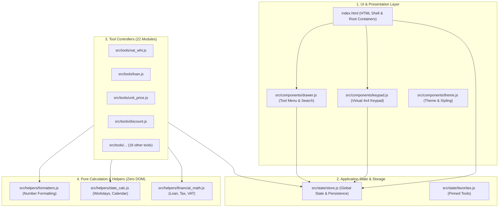

# รายงานการวิเคราะห์สถาปัตยกรรมและแผนการปรับปรุงโครงสร้างโค้ด
## Multitools Calculator (calculator_AIO)

**บทบาทผู้จัดทำ:** Senior Software Architect & Lead Frontend Engineer  
**วันที่จัดทำ:** 15 ตุลาคม 2569 (2026-10-15)  
**เวอร์ชันเอกสาร:** 1.0  
**สถานะ:** เอกสารข้อเสนอแนะเชิงสถาปัตยกรรมและแผนปฏิบัติการ (Architectural Advisory & Refactoring Roadmap)

---

## 1. บทสรุปการประเมินสถาปัตยกรรมปัจจุบัน (Executive Architectural Assessment)

ปัจจุบันแอปพลิเคชัน `calculator_AIO` เป็นระบบ **Single-File Monolithic Web App** ที่มีขนาดไฟล์ `index.html` มากกว่า **4,300 บรรทัด** (ประมาณ 280 KB) รวมโค้ด HTML, CSS Variables, การตั้งค่า PWA/Service Worker, Mock Database, State Management, และระบบเรนเดอร์คำนวณของเครื่องมือทั้ง 22 ตัวไว้ในไฟล์เดียว

### การวินิจฉัยเชิงวิศวกรรม:
> [!IMPORTANT]
> **การมีโค้ด 4,300 บรรทัดในไฟล์เดียวถือเป็น "จุดอ่อนและหนี้ทางเทคนิคขั้นวิกฤต (Critical Technical Debt)" ในมิติของการพัฒนาและบำรุงรักษา (Maintainability & Developer Velocity)** แม้ว่าจะให้ความสะดวกในด้านการติดตั้งหรือการเปิดใช้งานโดยไม่ต้องมีขั้นตอน Build (Zero-Build Step) ในช่วงเริ่มต้นก็ตาม

---

## 2. ตารางวิเคราะห์ข้อดี vs จุดอ่อนของโครงสร้างปัจจุบัน

| มิติ | โครงสร้างปัจจุบัน (Single-File Monolith 4,300 บรรทัด) | ผลกระทบต่อโครงการ |
| :--- | :--- | :--- |
| **รัศมีผลกระทบข้างเคียง (Blast Radius)** | ทุกฟังก์ชันอยู่ใน Scope เดียวกัน ใช้ `appState` ร่วมกัน | **ความเสี่ยงสูงมาก:** แก้ไขฟังก์ชันแกนกลาง (เช่น `formatInputDisplay`, `parseNumericInput`, คีย์แพด) มีโอกาสทำให้เครื่องมืออื่นอีก 15–20 ตัวพังตามไปด้วย |
| **การทดสอบความถูกต้อง (Testability)** | โค้ด JavaScript ฝังแน่นใน `<script>` ของ HTML | **เปราะบาง:** ชุดทดสอบ (`correctness.test.cjs`) ต้องใช้ Regex และ `vm.runInContext` แยกดึงโค้ดออกมาทดสอบ ไม่สามารถ `import` ฟังก์ชันตรงๆ ได้ |
| **ภาระทางสมองของนักพัฒนา (Cognitive Load)** | รวมทุกเรื่องในไฟล์เดียว (CSS, HTML, State, Math, DOM) | **ช้าและผิดพลาดง่าย:** เลื่อนหาโค้ดช้า คำค้นหาซ้ำซ้อนกันมากในไฟล์ยาว |
| **การทำงานร่วมกันผ่าน Git (Collaboration)** | ทุกการแก้ไขชนกันที่ไฟล์ `index.html` | **เกิด Merge Conflict สูง:** หากทำงานพร้อมกัน 2 คนหรือทำ 2 ฟีเจอร์พร้อมกัน จะชนกันแทบทุกครั้ง |
| **การแบ่งแยกหน้าที่ (Separation of Concerns)** | ฟังก์ชันหนึ่งตัวทำหลายอย่างพร้อมกัน เช่น `renderVatWhtTool` คำนวณเลข + สร้าง HTML + ผูก Event Listener | **ยากต่อการรียูส:** สูตรคำนวณผูกติดกับ DOM Elements ไม่สามารถแยกไปประมวลผลอิสระได้ |

---

## 3. ผังโครงสร้างสถาปัตยกรรมเป้าหมาย (Target Modular Architecture)



---

## 4. แผนงานการปรับปรุงโครงสร้างเป็นโมดูล (Refactoring Roadmap)

การปรับปรุงโครงสร้างสามารถทำได้โดย **ไม่ต้องรื้อระบบทิ้งทั้งหมด และไม่กระทบหน้าตา UI ของผู้ใช้** โดยแบ่งออกเป็น 3 ขั้นตอน:

### ระยะที่ 1: แยกฟังก์ชันแกนกลางออกเป็น Native ES Modules (ยังคง Zero-Build)
* **วิธีทำ:** ใช้ `<script type="module" src="src/app.js">` ซึ่งเบราว์เซอร์ยุคใหม่รองรับ 100% โดยไม่ต้องติดตั้ง Node.js หรือ Bundler
* **โครงสร้างโฟลเดอร์เป้าหมาย:**
  ```text
  calculator_AIO/
  ├── index.html                   (เหลือเฉพาะโครงสร้าง HTML ~150 บรรทัด)
  ├── src/
  │   ├── app.js                   (Bootstrap & Event routing)
  │   ├── catalog.js               (TOOLS_CATALOG 22 เครื่องมือ)
  │   ├── state.js                 (appState, localStorage persistence)
  │   ├── helpers/
  │   │   ├── formatters.js        (parseNumericInput, formatInputDisplay, formatMoney)
  │   │   ├── date_utils.js        (countWorkingDays, Thai calendar eras)
  │   │   └── keypad.js            (On-screen keypad & keyboard mapping)
  │   └── tools/                   (แยกเครื่องมือละ 1 ไฟล์ ~80-120 บรรทัด)
  │       ├── vat_wht.js
  │       ├── unit_price.js
  │       ├── discount.js
  │       └── ...
  ```
* **ประโยชน์ทันที:**
  - `index.html` เบาลงทันทีจาก 4,300 บรรทัด เหลือ 150 บรรทัด
  - เมื่อเกิดบั๊กในเครื่องมือใด เช่น "ราคาต่อหน่วย" แก้ไขเฉพาะไฟล์ `src/tools/unit_price.js` โดยไม่มีความเสี่ยงกระทบเครื่องมืออื่น
  - เขียน Unit Test ใน `tests/` ได้ง่ายด้วยมาตรฐาน `import { ... } from '../src/helpers/formatters.js'`

### ระยะที่ 2: แยกสูตรคำนวณ (Pure Functions) ออกจากการสร้างหน้าจอ (DOM Rendering)
* แยกโค้ดแต่ละเครื่องมือออกเป็น 2 ส่วน:
  1. **Calculation Function (Pure Logic):** รับเฉพาะค่าตัวเลข $\rightarrow$ คืนค่าผลลัพธ์ (ไม่มี DOM ไม่มี HTML) ทำให้ทดสอบ Unit Test ได้ 100%
  2. **Render Function (DOM Binding):** มีหน้าที่นำผลลัพธ์ไปใส่ใน HTML และผูก Event

### ระยะที่ 3: นำเครื่องมือ Modern Tooling เข้ามาช่วย (เมื่อพร้อมขยายสู่ Production เต็มรูปแบบ)
* นำ **Vite** เข้ามาทำหน้าที่ Bundle และ Minify โค้ดให้เป็นไฟล์ขนาดเล็กมากสำหรับการโหลดผ่านมือถือที่เน็ตช้า
* เพิ่ม **TypeScript/JSDoc** เพื่อให้โปรแกรมช่วยเตือนประเภทตัวแปร (Type Safety) ป้องกันบั๊กค่า `NaN` หรือ String สลับกับ Number ตั้งแต่ตอนพิมพ์โค้ด

---

## 5. มาตรการป้องกันข้อผิดพลาดระหว่างการ Refactor (Zero-Regression Guardrails)

ก่อนและระหว่างการแยกไฟล์ ต้องยึดหลักเกณฑ์ความปลอดภัยดังนี้:
1. **Regression Baseline:** รัน `node --test calculator_AIO/tests/correctness.test.cjs` ให้ผ่าน 100% ทุกครั้งหลังแยกแต่ละโมดูล
2. **Behavioral Invariance:** ไม่แก้ไขพฤติกรรม UI, ลำดับการกดคีย์แพด, หรือการจัดเก็บ `localStorage` จนกว่าจะแยกไฟล์เสร็จสมบูรณ์
3. **One Tool at a Time:** แยกทีละ 1-2 เครื่องมือเพื่อความปลอดภัย ไม่ทำการย้ายทั้ง 22 ตัวพร้อมกันในครั้งเดียว

---

*เอกสารฉบับนี้ถูกจัดทำขึ้นเพื่อเป็นแนวทางอ้างอิงเชิงกลยุทธ์ด้านวิศวกรรมซอฟต์แวร์สำหรับทีมพัฒนา Multitools Calculator*
