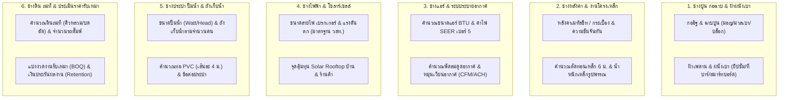

# แผนผังและสารบัญเครื่องคำนวณหมวดงานช่าง & ก่อสร้าง (Construction, Engineering & Handyman Roadmap)
> เอกสารรวบรวมไอเดียและข้อกำหนดทางเทคนิค (Functional & Technical Specifications) สำหรับขยาย **"หมวดงานช่าง & ก่อสร้าง"** ในระบบ **Multitools Calculator AIO** เพื่อตอบโจทย์ช่างรับเหมาไทย วิศวกรหน้างาน และเจ้าของบ้านที่รีโนเวทหรือต่อเติมบ้านด้วยตนเอง

---

## 📌 บทนำและสถานะปัจจุบัน (Current State)
ปัจจุบันในระบบ [`catalog.js`](file:///d:/www/Multitools/calculator_AIO/src/catalog.js) มีเครื่องมือที่เกี่ยวข้องกับงานช่างและพื้นที่อยู่ **2 เครื่องมือ**:
1. **`construction_calc`** (หมวด `shop`): คำนวณวัสดุก่อสร้างพื้นฐาน 3 แท็บย่อย ได้แก่ **ปูกระเบื้อง**, **ทาสีอาคาร**, และ **เทพื้นคอนกรีต** ([`shop.js`](file:///d:/www/Multitools/calculator_AIO/src/tools/shop.js#L1467-L1954))
2. **`area_cost`** (หมวด `special`): คำนวณต้นทุนต่อพื้นที่ ไร่-งาน-ตารางวา ([`special.js`](file:///d:/www/Multitools/calculator_AIO/src/tools/special.js))

เอกสารฉบับนี้เสนอการยกระดับและขยายเครื่องมือสายงานช่างให้ครบวงจรตามมาตรฐานงานก่อสร้างและวิศวกรรมในประเทศไทย (วสท. / กฟน. / กฟภ. / มาตรฐานวัสดุก่อสร้างไทย)

---

## 🗺️ โครงสร้างหมวดหมู่เครื่องคำนวณงานช่าง 6 กลุ่มหลัก

---

## 🛠️ รายละเอียดข้อกำหนดเครื่องคำนวณแต่ละกลุ่ม (Detailed Specifications)

### กลุ่มที่ 1: ช่างปูน ช่างก่อฉาบ & โครงสร้างเบา (Masonry & Drywall)
สามารถพัฒนาเป็นเครื่องมือใหม่ หรือเพิ่มเป็นแท็บต่อยอดใน [`construction_calc`](file:///d:/www/Multitools/calculator_AIO/src/tools/shop.js#L1467-L1954)

#### 1.1 คำนวณก่ออิฐ & ฉาบปูน (`wall_masonry`)
* **Pain Point:** ช่างและเจ้าของบ้านต้องการกั้นห้องใหม่แต่ไม่ทราบว่าต้องสั่งอิฐกี่ก้อน ปูนก่อกี่ถุง ปูนฉาบกี่ถุง และหากเลือกอิฐมวลเบาแทนอิฐมอญจะประหยัดค่าโครงสร้างและค่าแรงกว่ากันเท่าไหร่
* **ตัวแปรนำเข้า (Inputs):**
  * ความยาวผนังรวม (เมตร) × ความสูงผนัง (เมตร)
  * พื้นที่หักออก (ประตู / หน้าต่าง / ช่องลม เป็น ตร.ม.)
  * ประเภทอิฐที่เลือกใช้:
    1. **อิฐมวลเบา (ขนาด 20×60 ซม. หนา 7.5 หรือ 10 ซม.):** ใช้ `8.33 ก้อน/ตร.ม.`
    2. **อิฐมอญแดงก้อนเล็ก (ก่อครึ่งแผ่น / เต็มแผ่น):** ก่อครึ่งแผ่นใช้ `~120-130 ก้อน/ตร.ม.`, ก่อเต็มแผ่นใช้ `~240-260 ก้อน/ตร.ม.`
    3. **อิฐบล็อก (ขนาด 19×39 ซม.):** ใช้ `12.5 ก้อน/ตร.ม.`
  * การฉาบปูน: ฉาบ 1 ด้าน หรือ ฉาบ 2 ด้าน (ความหนาฉาบเฉลี่ย 1.5 ซม.)
* **ผลลัพธ์ที่แสดง (Outputs):**
  * พื้นที่ก่อสุทธิ (ตร.ม.) และพื้นที่ฉาบสุทธิ (ตร.ม.)
  * จำนวนก้อนอิฐที่ต้องสั่งซื้อ (รวมเผื่อแตกหัก 5-10%)
  * จำนวนปูนก่อสำเร็จรูป / ปูนก่ออิฐมวลเบา (ถุงละ 40-50 กก.)
  * จำนวนปูนฉาบสำเร็จรูป (ถุงละ 50 กก. ฉาบได้ ~2.0-2.5 ตร.ม. ที่ความหนา 1.5 ซม.)
  * ปริมาณทรายก่อและทรายฉาบละเอียด (คิว) กรณีไม่ได้ใช้ปูนสำเร็จรูป
  * เหล็กหนวดกุ้งและเสาเอ็น-ทับหลังโดยประมาณ + ประมาณการงบวัสดุและค่าแรง

#### 1.2 คำนวณฝ้าเพดาน & ผนังเบา ยิปซั่ม/สมาร์ทบอร์ด (`ceiling_drywall`)
* **Pain Point:** การสั่งของทำฝ้าเพดานมักตกหล่นอุปกรณ์โครงคร่าว (ซี-ไลน์, ยู-ไลน์, ลวดแขวน, สกรู, ผงยิปซั่ม)
* **สูตรและตรรกะการคำนวณ:**
  * **โหมดฝ้าฉาบเรียบ (แผ่นยิปซั่ม/ไฟเบอร์ซีเมนต์ ขนาดมาตรฐาน 1.20 × 2.40 ม. = 2.88 ตร.ม./แผ่น):**
    * $\text{จำนวนแผ่น} = \lceil (\text{พื้นที่ห้อง} \div 2.88) \times (1 + \text{เผื่อเศษ } 10\%) \rceil$
    * โครงคร่าว ซี-ไลน์ (C-Line ยาว 4 ม.), โครงริม ยู-ไลน์ (U-Line ยาว 4 ม.), ผงยิปซั่มฉาบรอยต่อ, ผ้าเทปยิปซั่ม และสกรูดำยิงฝ้า
  * **โหมดฝ้าทีบาร์ (T-Bar ขนาดแผ่น 60 × 60 ซม. = 0.36 ตร.ม./แผ่น):**
    * คำนวณจำนวนแผ่น + โครงทีบาร์ตัวหลัก (Main Tee), ตัวซอยสั้น/ยาว (Cross Tee) และฉากริมผนัง (Wall Angle)

---

### กลุ่มที่ 2: ช่างหลังคา ช่างเหล็ก & งานต่อเติม (Roofing & Metal Work)

#### 2.1 คำนวณหลังคาเมทัลชีท / กระเบื้อง & โครงหลังคา (`roof_calc`)
* **รหัสโมดูลแนะนำ:** `roof_calc`
* **Pain Point:** งานต่อเติมกันสาด โรงจอดรถ และครัวไทยหลังบ้าน ต้องคำนวณความยาวแผ่นหลังคาตามความลาดเอียง (Slope) และสั่งตัดเมทัลชีทจากโรงงานตามความยาวจริงรวมถึงวางระยะแปไม่ให้แอ่น
* **สูตรและตรรกะการคำนวณ:**
  * **คำนวณความยาวจันทัน (Rafter Length) ตามความชัน:**
    $$\text{ความยาวจันทัน} = \sqrt{\text{ระยะยื่นแนวราบ (Run)}^2 + \text{ระยะยกสูง (Rise)}^2} + \text{ชายคายื่น (Overhang)}$$
    *(รองรับการกรอกเป็น "องศาความชัน" เช่น 5°, 15°, 30° หรือกรอกเป็น "ระยะยกสูง ซม." โดยตรง)*
  * **จำนวนแผ่นหลังคาเมทัลชีท (หน้ากว้างใช้งานจริง 0.76 เมตร หลังหักซ้อนลอน):**
    $$\text{จำนวนแผ่น} = \lceil \text{ความกว้างแนวจั่ว} \div 0.76 \rceil$$
  * **ระยะแปและจำนวนท่อนเหล็กแป:**
    * เมทัลชีททั่วไป: ระยะแปห่าง `1.00 - 1.50 เมตร`
    * กระเบื้องลอนคู่ (`50 × 120 ซม.`): ระยะแปห่างมาตรฐาน `1.00 เมตร`
* **ผลลัพธ์ที่แสดง:**
  * ความยาวแผ่นเมทัลชีทที่ต้องสั่งตัดต่อแผ่น (เมตร) × จำนวนแผ่นทั้งหมด
  * พื้นที่หลังคารวมตามแนวลาดเอียง (ตร.ม.) สำหรับคิดราคา PU Foam / แผ่นฉนวน PE
  * จำนวนสกรูยิงหลังคา (ประมาณ 4-6 ตัว/ตร.ม.) และแผ่นครอบสันหลังคา/ครอบข้าง
  * จำนวนท่อนเหล็กกล่อง (ความยาวมาตรฐานท่อนละ **6.00 เมตร**) สำหรับทำแปและจันทัน

#### 2.2 คำนวณน้ำหนักเหล็ก & วางแผนตัดเหล็กเส้น/เหล็กรูปพรรณ (`steel_optimizer`)
* **Pain Point:** ช่างเหล็กซื้อเหล็กกล่องหรือเหล็กเส้นยาวท่อนละ 6 เมตร (หรือ 10 เมตร) แล้วต้องนำมาตัดเป็นท่อนสั้นๆ หลายขนาด หากจัดเรียงไม่ดีจะเสียเศษเหล็กทิ้งจำนวนมาก และต้องการรู้น้ำหนักรวมเพื่อเช็กราคาเหล็กตามกิโลกรัม
* **ฟีเจอร์เด่น:**
  * **1D Cutting Stock Optimizer:** กรอกความยาวเหล็กเต็มเส้น (เช่น 6.00 ม.) และรายการความยาวท่อนย่อยที่ต้องการตัด ระบบคำนวณแผนการตัดที่เสียเศษเหล็ก (Waste) น้อยที่สุดพร้อมบอกจำนวนเส้นเต็มที่ต้องซื้อ
  * **ตารางน้ำหนักเหล็กมาตรฐาน มอก.:** เหล็กกล่องสี่เหลี่ยม/แบน, เหล็กตัว C, เหล็กเส้นกลม (RB6, RB9), เหล็กข้ออ้อย (DB12, DB16, DB20)

---

### กลุ่มที่ 3: ช่างแอร์ & ระบบทำความเย็น/ระบายอากาศ (HVAC & Ventilation)

#### 3.1 คำนวณขนาดแอร์ BTU & ประหยัดไฟเบอร์ 5 (`btu_calc`)
* **รหัสโมดูลแนะนำ:** `btu_calc`
* **Pain Point:** เป็นหนึ่งในคำค้นหาที่สูงที่สุดของคนไทยเวลาซื้อแอร์ใหม่หรือกั้นห้องเพิ่ม หากเลือก BTU ต่ำไปคอมเพรสเซอร์จะทำงานหนักตลอดเวลาและกินไฟ หากเลือกสูงเกินไปจะสิ้นเปลืองงบซื้อเครื่อง
* **สูตรและตรรกะการคำนวณ (มาตรฐานช่างแอร์ไทย):**
  $$\text{BTU} = \text{กว้าง (ม.)} \times \text{ยาว (ม.)} \times \text{ตัวคูณภาระความร้อน (Multiplier)}$$
  *(ปรับแต่งเพิ่มหากความสูงเพดานเกิน 2.80 เมตร)*
  * **ตัวคูณตามประเภทห้องและทิศทางแดด:**
    * ห้องนอนปกติ (ไม่โดนแดดบ่าย): `700 - 750 BTU/ตร.ม.`
    * ห้องนอน (โดนแดดบ่าย / ชั้นบนสุดใต้หลังคา): `800 - 900 BTU/ตร.ม.`
    * ห้องนั่งเล่น / ห้องทำงานกลางวัน: `850 - 950 BTU/ตร.ม.`
    * ห้องนั่งเล่นโดนแดดจัด / กระจกเยอะ: `1,000 - 1,100 BTU/ตร.ม.`
    * ร้านค้า / สำนักงาน / ร้านอาหารที่มีคนเข้าออกบ่อย: `1,200 - 1,500 BTU/ตร.ม.`
* **ผลลัพธ์ที่แสดง:**
  * ค่า BTU ที่คำนวณได้จริง และ **ขนาดแอร์มาตรฐานในท้องตลาดที่แนะนำ** (`9,000` / `12,000` / `15,000` / `18,000` / `24,000` / `30,000` / `36,000` BTU)
  * เปรียบเทียบค่าไฟฟ้าต่อเดือนและต่อปีระหว่าง **แอร์ธรรมดา (Fixed Speed)** vs **แอร์ Inverter (SEER สูง)**
  * ปุ่มส่งค่าวัตต์แอร์ไปยังเครื่องมือ [`electricity_bill`](file:///d:/www/Multitools/calculator_AIO/src/tools/lifestyle_thai.js) เพื่อรวมในบิลค่าไฟบ้านได้ทันที

---

### กลุ่มที่ 4: ช่างไฟฟ้า & พลังงานแสงอาทิตย์ (Electrical & Solar)

#### 4.1 คำนวณขนาดสายไฟ เบรกเกอร์ & แรงดันตก ตามมาตรฐาน วสท. (`wire_breaker`)
* **รหัสโมดูลแนะนำ:** `wire_breaker`
* **Pain Point:** ช่างไฟและเจ้าของบ้านต้องการติดเครื่องทำน้ำอุ่น (3,500W / 4,500W / 6,000W), เตาแม่เหล็กไฟฟ้า, แอร์ หรือเครื่องชาร์จรถยนต์ไฟฟ้า (EV Charger 7.4kW / 22kW) แต่ไม่มั่นใจว่าต้องเดินสายไฟขนาดกี่ sq.mm. และใช้เบรกเกอร์กี่แอมป์ (A) เพื่อไม่ให้สายไฟร้อนละลายหรือแรงดันตกเมื่อเดินสายไกล
* **สูตรและตรรกะการคำนวณ (อ้างอิงมาตรฐานการติดตั้งทางไฟฟ้าสำหรับประเทศไทย วสท. / กฟน. / กฟภ.):**
  * **คำนวณกระแสไฟฟ้าใช้งาน ($I$):**
    * ระบบ 1 เฟส (230V): $I = \frac{P}{\text{230} \times \text{PF}}$
    * ระบบ 3 เฟส (400V): $I = \frac{P}{\sqrt{3} \times \text{400} \times \text{PF}}$
  * **ขนาดเบรกเกอร์ ($I_B$):** เลือกพิกัดมาตรฐาน (`10A`, `16A`, `20A`, `25A`, `32A`, `40A`, `50A`, `63A`, `100A`) โดยคิดเผื่อโหลดต่อเนื่อง $1.25 \times I$
  * **ขนาดสายไฟทองแดง (IEC 01 / THW, VAF, NYY, CV):** เทียบตารางพิกัดกระแสสายไฟ ($I_Z \ge I_B$) ตามวิธีการเดินสาย (เดินเกาะผนัง / ร้อยท่อในอากาศ / ร้อยท่อฝังดิน)
  * **คำนวณแรงดันตก (Voltage Drop %):**
    $$\text{Voltage Drop (\%)} = \frac{\text{mV/A/m} \times I \times \text{ความยาวสาย (เมตร)}}{1000 \times V} \times 100$$
    *(แจ้งเตือนหากแรงดันตกเกิน 3% หรือ 5% พร้อมแนะนำให้ขยับขนาดสายไฟขึ้น 1 เบอร์อัตโนมัติ)*
* **Preset อุปกรณ์ยอดนิยม:** เครื่องทำน้ำอุ่น 3,500W / 4,500W, น้ำร้อน 6,000W, แอร์ 12,000-24,000 BTU, ตู้เชื่อมอินเวอร์เตอร์, EV Wallbox 7.4kW (32A), มิเตอร์บ้าน 15(45)A และ 30(100)A

#### 4.2 คำนวณขนาดและจุดคุ้มทุน Solar Rooftop (`solar_rooftop`)
* **รหัสโมดูลแนะนำ:** `solar_rooftop`
* **Pain Point:** เจ้าของบ้านและโฮมออฟฟิศที่ค่าไฟเดือนละ 3,000 - 20,000 บาท อยากรู้ว่าติดโซลาร์เซลล์ขนาดกี่ kW ถึงจะเหมาะกับพฤติกรรมการใช้ไฟกลางวัน และกี่ปีถึงจะคืนทุน
* **ตรรกะการคำนวณ:**
  * กรอกค่าไฟฟ้าเฉลี่ยต่อเดือน (บาท) หรือหน่วยไฟต่อเดือน (kWh)
  * เลือกสัดส่วนการใช้ไฟช่วงกลางวัน (09:00 - 16:00 น.) เช่น `30%` (บ้านอยู่อาศัยทำงานนอกบ้าน), `50%` (Work from Home / มีผู้สูงอายุอยู่บ้าน), `70-80%` (ร้านค้า / คาเฟ่ / ออฟฟิศ)
  * คำนวณจากค่าเฉลี่ยชั่วโมงแดดในประเทศไทย (`Peak Sun Hours ≈ 4.0 - 4.5 ชม./วัน`)
* **ผลลัพธ์ที่แสดง:**
  * ขนาดระบบ Inverter ที่แนะนำ (`3 kW`, `5 kW`, `10 kW`, `15 kW`) และระบบไฟ (1 เฟส / 3 เฟส)
  * จำนวนแผงโซลาร์เซลล์ (อ้างอิงแผงรุ่นมาตรฐาน ~550W - 600W/แผง) และพื้นที่หลังคาที่ต้องใช้ (ตร.ม.)
  * เงินค่าไฟที่ประหยัดได้ต่อเดือนและต่อปี
  * **จุดคุ้มทุน (Payback Period):** จำนวนปีและเดือนที่คืนทุน + กำไรสะสมตลอดอายุแผง 25 ปี

---

### กลุ่มที่ 5: ช่างประปา ปั๊มน้ำ & ถังเก็บน้ำ (Plumbing & Water System)

#### 5.1 คำนวณขนาดปั๊มน้ำ ถังเก็บน้ำ & ท่อประปา (`plumbing_pump`)
* **รหัสโมดูลแนะนำ:** `plumbing_pump`
* **Pain Point:** ซื้อถังเก็บน้ำเล็กเกินไปน้ำไม่พอใช้เวลาประปาไม่ไหล หรือซื้อปั๊มน้ำวัตต์ต่ำไปเปิดฝักบัวชั้น 2-3 พร้อมกันแล้วน้ำไหลเบา
* **ตรรกะการคำนวณ:**
  * **ขนาดถังเก็บน้ำ (Water Tank):**
    $$\text{ความจุถัง (ลิตร)} = \text{จำนวนผู้อยู่อาศัย} \times 200\text{ ลิตร/คน/วัน} \times \text{จำนวนวันสำรองน้ำ (1-2 วัน)}$$
    * แนะนำขนาดถังมาตรฐานในไทย: `500L`, `700L`, `1,000L`, `1,500L`, `2,000L`, `3,000L`
  * **ขนาดปั๊มน้ำอัตโนมัติ (Water Pump):**
    * คำนวณระยะส่งสูง (Total Head) จากจำนวนชั้นของบ้าน + แรงดันที่ปลายก๊อก/เครื่องทำน้ำอุ่น
    * คำนวณอัตราการไหล (Flow Rate: ลิตร/นาที) จากจำนวนจุดใช้น้ำที่เปิดพร้อมกัน
    * แนะนำขนาดปั๊มมาตรฐาน: `100W - 150W` (บ้าน 1-2 ชั้น), `200W - 250W` (บ้าน 2-3 ชั้น), `300W - 400W` (บ้าน 3-4 ชั้น / ใช้น้ำหลายจุดพร้อมกัน)

---

### กลุ่มที่ 6: ช่างดิน ถมที่ & บริหารงานรับเหมา (Earthwork & Contractor BOQ)

#### 6.1 คำนวณดินถมที่ & จำนวนเที่ยวรถดั๊มพ์ (`land_fill_calc`)
* **รหัสโมดูลแนะนำ:** `land_fill_calc`
* **Pain Point:** เจ้าของที่ดินและผู้รับเหมาถมดินสับสนระหว่างปริมาตรดินตาม геометриพื้นที่จริง (คิวบดอัดแน่น) กับปริมาตรดินบนรถบรรทุก (คิวหลวม) ซึ่งดินจะยุบตัวหลังบดอัดประมาณ `20% - 30%`
* **สูตรและตรรกะการคำนวณ:**
  * รองรับการกรอกพื้นที่ทั้งแบบ **ไร่ - งาน - ตารางวา** และ **กว้าง × ยาว (เมตร)** (1 ไร่ = 1,600 ตร.ม., 1 งาน = 400 ตร.ม., 1 ตร.วา = 4 ตร.ม.)
  * กรอกความสูงที่ต้องการถมเฉลี่ย (เช่น ถมสูง 50 ซม. หรือ 1.20 เมตร)
  * **ปริมาตรดิน геометриสุทธิ (คิวแน่น):** $\text{พื้นที่ (ตร.ม.)} \times \text{ความสูงถม (ม.)}$
  * **ปริมาตรดินที่ต้องสั่งซื้อจริง (คิวหลวม):** $\text{คิวแน่น} \times \text{ตัวคูณเผื่อยุบตัว (1.25 - 1.35 ตามชนิดดิน: ดินดาน / ดินลูกรัง / ดินเหนียว / ทรายถม)}$
* **ผลลัพธ์ที่แสดง:**
  * ปริมาตรดินสุทธิ (คิวแน่น) vs ปริมาตรดินเผื่อยุบตัว (คิวหลวม)
  * จำนวนเที่ยวรถบรรทุกโดยประมาณ: **รถ 6 ล้อดั๊มพ์** (ประมาณ 5-6 คิว/คัน) vs **รถ 10 ล้อดั๊มพ์** (ประมาณ 12-14 คิว/คัน)
  * ประมาณการงบประมาณรวม (คิดแบบเหมาเป็นคิว หรือ เหมาเป็นเที่ยวรถ + ค่าเกลี่ยและบดอัด)

#### 6.2 แบ่งงวดงานรับเหมา & เงินประกันผลงาน (`contractor_payment`)
* **รหัสโมดูลแนะนำ:** `contractor_payment`
* **Pain Point:** เวลาจ้างช่างรับเหมาต่อเติมบ้านหรือสร้างบ้าน มักมีปัญหาเรื่องการแบ่งงวดจ่ายเงินไม่สมดุลกับเนื้องาน รวมถึงการหักเงินประกันผลงาน (Retention) และภาษีหัก ณ ที่จ่าย 3%
* **ฟีเจอร์เด่น:**
  * กรอกมูลค่างานตามสัญญาจ้าง (บาท) และเลือกเทมเพลตแบ่งงวดงานมาตรฐาน (เช่น แบ่ง 3 งวดงานรีโนเวท, แบ่ง 4 งวดงานต่อเติม, แบ่ง 6-10 งวดงานสร้างบ้าน) หรือปรับ % แต่ละงวดเอง
  * คำนวณยอดหักเงินประกันผลงาน (Retention 5% หรือ 10%) ในแต่ละงวด
  * คำนวณภาษีหัก ณ ที่จ่าย 3% (กรณีผู้ว่าจ้างเป็นนิติบุคคล) และ VAT 7% พร้อมปุ่มพิมพ์ตารางงวดงานแนบสัญญาจ้าง (`generateFormalPrintHTML`)

---

## 🏗️ แนวทางการจัดหมวดหมู่ในระบบ (`catalog.js`)

สามารถเลือกจัดโครงสร้างใน [`catalog.js`](file:///d:/www/Multitools/calculator_AIO/src/catalog.js) ได้ **2 รูปแบบ**:

### ทางเลือกที่ 1: เปิดหมวดหมู่ที่ 6 ใหม่ชื่อ `"ช่าง & ก่อสร้าง"` (แนะนำหากเพิ่มเกิน 4 เครื่องมือ)
เพิ่มกลุ่มใหม่ `{ id: 'engineering', name: 'ช่าง & ก่อสร้าง' }` ใน `TOOL_GROUPS` และย้าย [`construction_calc`](file:///d:/www/Multitools/calculator_AIO/src/catalog.js#L30) มารวมกับเครื่องมือช่างใหม่ทั้งหมด:
* `construction_calc` — คำนวณวัสดุก่อสร้าง (กระเบื้อง / สี / คอนกรีต)
* `wall_ceiling_calc` — คำนวณก่ออิฐ ฉาบปูน & ฝ้าเพดาน
* `roof_steel_calc` — คำนวณหลังคาเมทัลชีท ความชัน & โครงเหล็ก
* `btu_calc` — คำนวณขนาดแอร์ BTU & ค่าไฟเบอร์ 5
* `wire_solar_calc` — คำนวณสายไฟ เบรกเกอร์ (วสท.) & โซลาร์เซลล์
* `land_fill_calc` — คำนวณดินถมที่ & รถดั๊มพ์ (ไร่-งาน-ตร.วา)
* `plumbing_pump` — คำนวณปั๊มน้ำ ถังเก็บน้ำ & ท่อประปา

### ทางเลือกที่ 2: คง 5 หมวดหมู่เดิม แต่จัดเป็น Super-Tools แบบมีแท็บย่อย
หากต้องการคงแถบหมวดหมู่ 5 หมวดเดิมไว้ ไม่ให้เมนูหลักยาวเกินไป สามารถรวมเครื่องมือช่างที่มีความเกี่ยวข้องกันไว้ในการ์ดเดียวแบบมี Segmented Tabs (เหมือนที่ [`construction_calc`](file:///d:/www/Multitools/calculator_AIO/src/tools/shop.js#L1515-L1525) มี 3 แท็บ):
1. ขยาย **`construction_calc`** (หมวด `shop`): เพิ่มแท็บ **ก่ออิฐ/ฉาบปูน** และ **หลังคา/โครงเหล็ก**
2. เพิ่ม **`btu_wire_solar`** (หมวด `special` คู่กับ `electricity_bill`): รวมงานระบบบ้าน **ขนาดแอร์ BTU**, **สายไฟ/เบรกเกอร์ วสท.**, และ **Solar Rooftop**
3. ขยาย **`area_cost`** (หมวด `special`): เพิ่มโหมด **คำนวณดินถมที่ (คิวแน่น/คิวหลวม & จำนวนรถดั๊มพ์)**

---

## 📊 ตารางจัดลำดับความสำคัญในการพัฒนา (Prioritization Matrix)

| ลำดับ | เครื่องมือ | รหัสโมดูล | กลุ่มเป้าหมาย | เหตุผลที่แนะนำให้ทำก่อน (Impact & Demand) |
| :---: | :--- | :--- | :--- | :--- |
| **อันดับ 1** | **คำนวณขนาดแอร์ BTU & ค่าไฟ Inverter** | `btu_calc` | เจ้าของบ้านทุกคน / ช่างแอร์ | Search Volume สูงมากในไทย ใช้งานง่าย เชื่อมต่อกับ `electricity_bill` ที่มีอยู่ได้ทันที |
| **อันดับ 2** | **คำนวณดินถมที่ (ไร่-งาน-วา) & รถดั๊มพ์** | `land_fill_calc` | เจ้าของที่ดิน / ผู้รับเหมาถมดิน | แก้ปัญหาเฉพาะตัวของคนไทยเรื่องหน่วยที่ดินไทยและการเผื่อดินยุบตัว คู่กับ `area_cost` และ `property_transfer` |
| **อันดับ 3** | **คำนวณขนาดสายไฟ เบรกเกอร์ & แรงดันตก (วสท.)** | `wire_breaker` | ช่างไฟฟ้า / คนติดแอร์ / คนติด EV Charger | มีประโยชน์ด้านความปลอดภัยสูงมาก ใช้มาตรฐานสายไฟไทย (THW/VAF/NYY) ที่เว็บต่างประเทศไม่มี |
| **อันดับ 4** | **คำนวณก่ออิฐ ฉาบปูน & ฝ้าเพดาน** | `wall_masonry` | ช่างปูน / ผู้รับเหมาต่อเติมบ้าน | เติมเต็ม `construction_calc` ให้ครบทั้ง พื้น + ผนัง + ฝ้าเพดาน |
| **อันดับ 5** | **คำนวณหลังคาเมทัลชีท ความชัน & โครงเหล็ก** | `roof_calc` | ช่างเหล็ก / ช่างหลังคาต่อเติมโรงรถ-ครัว | ช่วยถอดความยาวแผ่นตามความลาดเอียงและคำนวณท่อนเหล็ก 6 เมตรหน้างานได้ทันที |
| **อันดับ 6** | **คำนวณจุดคุ้มทุน Solar Rooftop** | `solar_rooftop` | เจ้าของบ้าน / ร้านค้า / ออฟฟิศ | เทรนด์ติดโซลาร์เซลล์ในไทยเติบโตสูงมาก ช่วยตัดสินใจขนาด kW และระยะเวลาคืนทุน |

---

## ✅ มาตรฐานทางเทคนิคเมื่อเริ่มพัฒนา (Implementation Checklist)
ตามกติกาใน [`AGENTS.md`](file:///d:/www/Multitools/calculator_AIO/AGENTS.md) และ [`THAI_CALCULATORS_ROADMAP.md`](file:///d:/www/Multitools/calculator_AIO/THAI_CALCULATORS_ROADMAP.md):
- ใช้คลาสส่วนประกอบกลาง (`themed-tool-card`, `themed-result-card`, `segment-group`, `airbnb-input`, `tool-chip-btn`) และตัวแปรสี `--app-*` รองรับครบทั้ง 5 ธีม (Airbnb, Classic, Dark Luxe, Together, Ferrari)
- เชื่อมช่องกรอกหลักเข้ากับคีย์แพดกลาง (`createKeypadFieldHTML` / `attachFieldClickListeners`)
- รองรับการแชร์ลิงก์ผ่าน URL (`syncUrl()`), ประวัติการคำนวณ (`localStorage`), การเปรียบเทียบ (`#compareModal`) และพิมพ์ใบสรุปรายการวัสดุ/BOQ (`generateFormalPrintHTML`)
- เขียนชุดทดสอบความถูกต้องของสูตรคำนวณใน [`calculator_AIO/tests/correctness.test.cjs`](file:///d:/www/Multitools/calculator_AIO/tests/correctness.test.cjs)
