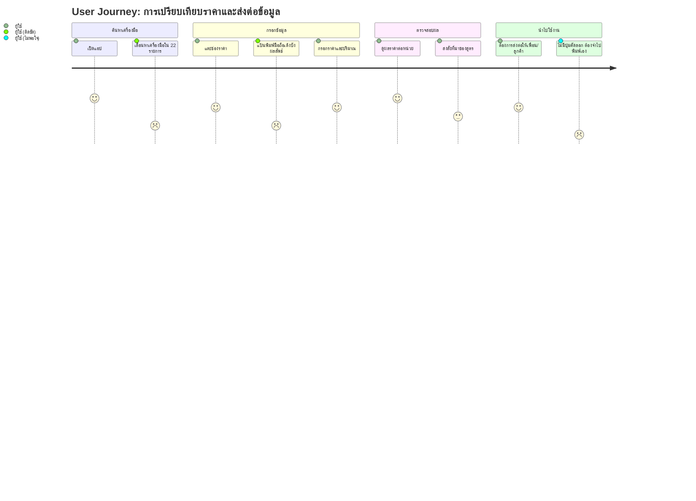
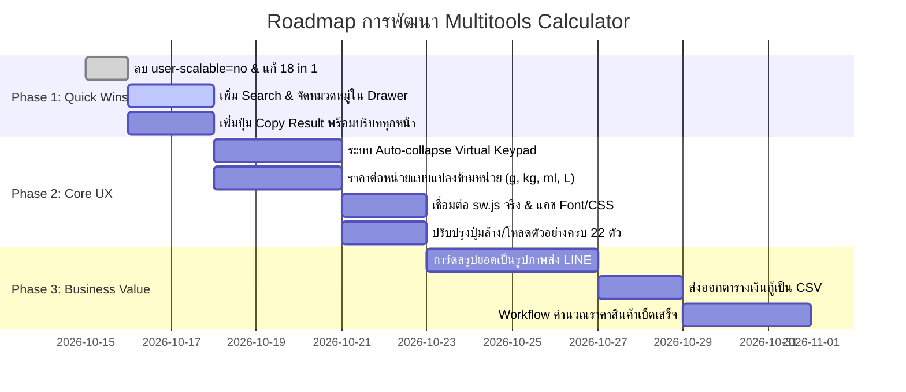

# รายงานกลยุทธ์ผลิตภัณฑ์และการปรับปรุง UX/UI — Multitools Calculator
**บทบาทผู้จัดทำ:** Lead Product Manager & Senior UX Specialist  
**วันที่จัดทำ:** 15 ตุลาคม 2569 (2026-10-15)  
**เวอร์ชันเอกสาร:** 1.0  
**สถานะ:** แผนกลยุทธ์และแนวทางปฏิบัติเชิงรูปธรรม (Actionable Strategy & Roadmap)

---

## 1. บทสรุปผู้บริหารและทิศทางผลิตภัณฑ์ (Executive Summary & Product Vision)

### 1.1 วิสัยทัศน์ผลิตภัณฑ์ (Product Vision)
ยกระดับ **Multitools Calculator** จาก "คอลเลกชันเครื่องคิดเลขบนเว็บ" สู่ **"เครื่องมือช่วยตัดสินใจเรื่องเงิน ต้นทุน และเวลา อันดับหนึ่งสำหรับผู้บริโภค ฟรีแลนซ์ และผู้ประกอบการไทย"**

### 1.2 การประเมินสถานะปัจจุบัน (Product Health Snapshot)
* **จุดแข็ง (Strengths):** รวม 22 เครื่องมือที่ตรงกับบริบทคนไทย (VAT 7%, หัก ณ ที่จ่าย, ราคาต่อหน่วย, วันทำการไทย, ไร่-งาน-วา, วางแผนเกษียณ) และระบบคำนวณแกนหลัก (Core Calculation & Dates) มีความแม่นยำสูง
* **จุดคอขวด (Critical Bottlenecks):**
  1. การค้นหาและเข้าถึงเครื่องมือทำได้ช้า (ไม่มี Search และขาดการจัดหมวดหมู่)
  2. แป้นตัวเลขเสมือน (Virtual Keypad) ซ้อนทับกับแป้นพิมพ์จริงบนมือถือ (Double Keyboards)
  3. ผลลัพธ์ขาดที่มา (Black-box) ทำให้ผู้ใช้ไม่กล้านำตัวเลขไปใช้งานต่อ
  4. ขาดฟังก์ชัน **"คัดลอกสรุปผลพร้อมบริบท"** เพื่อส่งต่อใน LINE หรืออีเมลทันที

---

## 2. การวิเคราะห์กลุ่มผู้ใช้และเส้นทางการใช้งาน (Target Personas & User Journeys)



### กลุ่มเป้าหมายหลัก (Primary Personas):
1. **ผู้ซื้อของ & ผู้บริโภคทั่วไป (Smart Shopper):**
   - *เป้าหมาย:* ซื้อของในซุปเปอร์มาร์เก็ตหรือออนไลน์ให้คุ้มที่สุด
   - *เครื่องมือหลัก:* ราคาต่อหน่วย (`unit_price`), ส่วนลด (`discount`), หารค่าข้าว (`tip`)
   - *ความต้องการ:* ใช้มือเดียวได้คล่อง, เปรียบเทียบสินค้าต่างขนาดต่างหน่วยได้ทันที (เช่น กรัม vs กิโลกรัม)
2. **ฟรีแลนซ์ & ร้านค้าออนไลน์ / SME (Micro-Entrepreneurs):**
   - *เป้าหมาย:* คิดราคาขาย คำนวณภาษี และแจ้งยอดโอนกับลูกค้าได้อย่างรวดเร็วและถูกต้อง
   - *เครื่องมือหลัก:* VAT + หัก ณ ที่จ่าย (`vat_wht`), กำไร/มาร์จิ้น (`percent`), จัดสรรเงินเดือน (`salary`)
   - *ความต้องการ:* ปุ่มคัดลอกข้อความสรุปพร้อมส่งใน LINE ทันที และออกใบสรุปราคาอย่างง่าย
3. **พนักงานออฟฟิศ & ผู้บริหารโครงการ (Project Coordinators):**
   - *เป้าหมาย:* คำนวณวันส่งมอบงานตามสัญญาและวันทำการจริง (SLA)
   - *เครื่องมือหลัก:* วันทำการ (`date_work`), คำนวณวันที่ (`date_calc`), เวลาโลก (`world_time`)
   - *ความต้องการ:* ปฏิทินวันหยุดราชการไทยที่ถูกต้องตามประกาศจริง และการนัดหมายข้ามเขตเวลา

---

## 3. User Flow & Usability Analysis (จุดติดขัดและแนวทางแก้ไข UX/UI)

### 3.1 การค้นหาและการจัดหมวดหมู่ (Information Architecture)
* **ปัญหา:** Drawer เมนูมี 22 รายการ แต่แบ่งเพียง "รายการโปรด" กับ "ทั้งหมด" ผู้ใช้ใหม่ต้องไล่กวาดสายตาหา และ Badge ยังเขียนว่า `18 in 1` ทำให้ภาพลักษณ์ดูไม่ทันสมัย
* **Actionable Advice:**
  1. เพิ่มช่องค้นหาด่วน (Quick Search Bar) ด้านบนสุดของ Drawer กรองเครื่องมือแบบ Real-time รองรับทั้งชื่อภาษาไทยและคีย์เวิร์ดภาษาอังกฤษ (เช่น `vat`, `ลด`, `วัน`, `loan`)
  2. จัดกลุ่มเครื่องมือตามภารกิจ (Job-to-be-Done):
     - 🛒 **ซื้อของ & ทั่วไป:** ราคาต่อหน่วย, ส่วนลด, ทิป/หารบิล, แปลงหน่วย
     - 💼 **ธุรกิจ & ค้าขาย:** VAT, VAT + หัก ณ ที่จ่าย, เปอร์เซ็นต์/กำไร, จัดสรรเงินเดือน
     - 🏦 **การเงิน & วางแผน:** เงินกู้/ผ่อนบ้าน, เงินออม/เกษียณ, สกุลเงิน
     - 📅 **เวลา & สำนักงาน:** วันทำการ/SLA, คำนวณวันที่, เวลาโลก, GPA
     - 🩺 **สุขภาพ & อื่นๆ:** สุขภาพ (BMI/BMR), วันตกไข่, เลขฐาน
  3. แก้ไขตัวเลข `18 in 1` ใน Header และ Canvas Generator ให้ดึงความยาวจาก `TOOLS_CATALOG.length` อัตโนมัติ (`22 in 1`)

### 3.2 ปัญหาแป้นพิมพ์ซ้อนบนมือถือ (Double Keyboards Clutter)
* **ปัญหา:** ช่องกรอกเป็น `<input>` จริง เมื่อแตะช่องกรอก แป้นพิมพ์จริงของมือถือจะเด้งขึ้นมา ขณะที่แป้นตัวเลขเสมือน (Virtual Keypad 4x4) ก็ตรึงอยู่ที่ด้านล่างจอ ส่งผลให้ผลลัพธ์ถูกบดบัง
* **Actionable Advice:**
  1. **ระบบ Auto-collapse Keypad:** เมื่อตรวจจับว่าผู้ใช้แตะ Input บนจอสัมผัส หรือกำลังพิมพ์ด้วยคีย์บอร์ดจริง ให้พับ Virtual Keypad ลงด้านล่างโดยอัตโนมัติ
  2. **ปุ่มสลับการมองเห็นแป้น:** เพิ่มปุ่ม Toggle `[⌨️ แป้นพิมพ์เสมือน]` เล็กๆ มุมขวาล่าง ให้ผู้ใช้เลือกเปิด/ปิดแป้นได้ตามความสะดวก
  3. **Responsive 2-Column บนจอกว้าง (Desktop/Tablet):** บนหน้าจอที่มีความกว้างมากกว่า 768px ให้แบ่งหน้าจอเป็น 2 คอลัมน์ (ฝั่งซ้าย = ฟอร์มกรอกข้อมูล, ฝั่งขวา = การ์ดสรุปผลลัพธ์ขนาดใหญ่)

### 3.3 การแสดงผลลัพธ์ที่มีบริบทและที่มา (Formula Transparency)
* **ปัญหา:** ผลลัพธ์แสดงเฉพาะตัวเลขลอยๆ เช่น `17.28 บาท/ชิ้น` ผู้ใช้ไม่สามารถตรวจสอบย้อนกลับได้ว่าระบบคิดอย่างไร
* **Actionable Advice:**
  - เพิ่มคอมโพเนนต์ `<details class="formula-breakdown">` ใต้การ์ดผลลัพธ์ แสดงที่มาของสูตรและตัวแปรที่นำมาคำนวณ เช่น:
    > 💡 **วิธีคิด:** `ราคา 864 บาท ÷ จำนวน 50 ชิ้น = 17.28 บาท/ชิ้น`  
    > 💡 **หัก ณ ที่จ่าย 3%:** `ยอดก่อน VAT 10,000 × 3% = 300 บาท`

### 3.4 การเข้าถึงและการใช้งานมือเดียว (Accessibility & Ergonomics)
* **ปัญหา:** ยังล็อก `user-scalable=no` ใน viewport ทำให้ผู้มีปัญหาทางสายตาขยายหน้าจอไม่ได้ และปุ่มปักหมุด `♥` มีขนาดเล็กเกินไป
* **Actionable Advice:**
  - ลบ `maximum-scale=1.0, user-scalable=no` ออกจาก `<meta name="viewport">`
  - ปรับขนาดปุ่มปักหมุดในเมนูให้มีพื้นที่สัมผัส (Touch Target) ขั้นต่ำ `44x44px`
  - ใส่แอตทริบิวต์ ARIA (`role="tablist"`, `role="tab"`, `aria-selected="true/false"`) ให้กับ Segmented Buttons ทุกชุด

---

## 4. Feature Gap Analysis (ฟังก์ชันสำคัญที่ต้องเพิ่มเติม)

### 4.1 GAP-1: ระบบคัดลอกและแชร์ผลลัพธ์พร้อมบริบท (One-Click Summary Copy)
* **ความสำคัญ:** P1 — ปัญหาใหญ่ที่สุดของการนำผลลัพธ์ไปใช้งานต่อ
* **Actionable Advice:** เพิ่มปุ่ม `📋 คัดลอกสรุป` ในทุกหน้า เพื่อจัดรูปแบบข้อความพร้อมส่งในแชททันที
* **รูปแบบข้อความตัวอย่าง (Ready-to-send Message):**
```text
📋 สรุปยอดวางบิล (บริการ)
----------------------------------
• ค่าบริการ: 10,000.00 บาท
• ภาษีมูลค่าเพิ่ม (VAT 7%): +700.00 บาท
• หักภาษี ณ ที่จ่าย (WHT 3%): -300.00 บาท
----------------------------------
💰 ยอดโอนสุทธิ: 10,400.00 บาท
(คำนวณโดย Multitools Calculator)
```

### 4.2 GAP-2: เปรียบเทียบราคาต่อหน่วยข้ามหน่วย (Cross-Unit Price Normalization)
* **ความสำคัญ:** P1
* **Actionable Advice:** 
  - เพิ่มตัวเลือกหน่วยต่อแถว: `กรัม (g)`, `กิโลกรัม (kg)`, `มิลลิลิตร (ml)`, `ลิตร (L)`, `ชิ้น (pcs)`
  - ระบบทำการแปลงเป็นหน่วยฐานอัตโนมัติ (เช่น แปลงเป็นกรัมหรือลิตรทั้งหมด) ก่อนคำนวณหาตัวเลือกที่คุ้มที่สุด
  - เพิ่มช่องใส่ชื่อสินค้า (เช่น "ร้าน A", "แบบถุงเติม") และปุ่มเพิ่มแถวได้มากกว่า 4 ตัวเลือก

### 4.3 GAP-3: ระบบประวัติและบันทึกชุดคำนวณ (Calculation History & Saved Sets)
* **ความสำคัญ:** P1
* **Actionable Advice:**
  - เพิ่มแท็บ **"ประวัติล่าสุด 10 รายการ"** ใน Drawer เมนู
  - เพิ่มปุ่ม **"💾 บันทึกชุดนี้"** ให้ผู้ใช้ตั้งชื่อชุดคำนวณได้ เช่น *"ผ่อนบ้าน ธนาคาร A vs B"* เก็บไว้ใน `localStorage` และสามารถเปิดกลับมาแก้ไขได้

### 4.4 GAP-4: เอนจินปฏิทินวันหยุดไทยตามประกาศจริง (Official Thai Holidays Engine)
* **ความสำคัญ:** P1
* **Actionable Advice:**
  - ปรับปรุงจากวันหยุดคงที่ 11 วัน ไปเป็นปฏิทินวันหยุดราชการรายปีจริง (ครอบคลุมปี 2568–2570)
  - รองรับวันหยุดชดเชย (Substitute Holidays) และวันสำคัญทางศาสนาที่คำนวณตามปฏิทินจันทรคติ (วันมาฆบูชา, วันวิสาขบูชา, วันอาสาฬหบูชา)

### 4.5 GAP-5: การทำงานแบบ Offline 100% (True Offline & PWA Strategy)
* **ความสำคัญ:** P1
* **Actionable Advice:**
  - เปลี่ยนการลงทะเบียน Service Worker จาก Blob URL มาเป็นการเชื่อมโยงไฟล์ [sw.js](file:///d:/www/Multitools/calculator_AIO/sw.js) โดยตรง
  - เพิ่มกลยุทธ์แคชภายนอกสำหรับ Tailwind CSS CDN และ Google Fonts
  - เพิ่มแถบสถานะออฟไลน์ (Offline Banner) แจ้งให้ผู้ใช้ทราบเมื่อไม่มีการเชื่อมต่ออินเทอร์เน็ต

---

## 5. Edge Cases & Risk Prevention (กรณีใช้งานผิดวิธีและการป้องกัน)

| สถานการณ์ (Edge Case) | พฤติกรรมปัจจุบัน / ความเสี่ยง | แนวทางป้องกันที่ถูกต้อง (Actionable Logic) |
|---|---|---|
| **กรอกส่วนลดเกิน 100%** | ราคาสุทธิและเงินที่ประหยัดแสดงผลติดลบ | ล็อกขอบเขต `0 <= discount <= 100%` หากเกินให้แสดงข้อความเตือนสีส้มใต้ช่อง |
| **ความสับสนระหว่าง Markup กับ Margin** | พ่อค้าแม่ค้าคิดว่ากำไร 20% บนต้นทุนคือกำไร 20% จากยอดขาย | ในโหมดกำไร ให้แสดงเปรียบเทียบทั้ง 2 ค่าคู่กันเสมอ เช่น `Markup: 25% (กำไรบนทุน)` vs `Margin: 20% (กำไรบนราคาขาย)` |
| **เงินกู้ผ่อนต่ำกว่าดอกเบี้ยรายงวด** | เงินต้นไม่ลด ดอกเบี้ยทบต้นจนยอดเงินงวดติดลบหรือระบบค้าง | ตรวจสอบว่า `ยอดผ่อนต่องวด > เงินต้น x อัตราดอกเบี้ยรายเดือน` หากน้อยกว่าให้ขึ้นเตือนสีแดงทันที |
| **ใส่วันที่สิ้นสุดก่อนวันที่เริ่มต้น** | บางเครื่องมือให้ผลลัพธ์ติดลบ บางเครื่องมือเกิด Error | ตรวจสอบและสลับวันให้อัตโนมัติพร้อมขึ้น Badge แจ้งว่า *"สลับวันที่เพื่อคำนวณระยะห่าง"* |
| **การโหลดตัวอย่างทับการตั้งค่าอื่น** | กดโหลด Demo แล้วล้างค่าตัวแปรอื่นในเครื่องมือจนหมด | ให้ฟังก์ชันโหลดตัวอย่างอัปเดตเฉพาะฟิลด์นำเข้าหลัก โดยไม่เขียนทับโครงสร้าง Object ทั้งหมด |

---

## 6. Value-Add Solutions & PMF Expansion (กลยุทธ์ต่อยอดคุณค่าทางธุรกิจ)

### 6.1 Smart Commerce Bundle (รวมขั้นตอนพ่อค้าแม่ค้าในหน้าเดียว)
* **แนวคิด:** เชื่อมโยง 4 เครื่องมือที่ใช้บ่อยเข้าด้วยกันเป็นขั้นตอนเดียว:
  $$\text{ต้นทุนต่อชิ้น} \xrightarrow{+\text{Margin \%}} \text{ราคาตั้งขาย} \xrightarrow{-\text{ส่วนลดโปรโมชั่น}} \text{ราคาสุทธิ} \xrightarrow{+\text{VAT / ค่าส่ง}} \text{ยอดเก็บเงิน}$$
* **คุณค่า:** ช่วยให้ร้านค้าออนไลน์ตั้งราคาขายได้ทันทีโดยไม่ต้องเปิด 4 หน้าคำนวณสลับไปมา

### 6.2 Instant Quote / Invoice Slip Generator (การ์ดสรุปราคาพร้อมส่ง)
* **แนวคิด:** เพิ่มปุ่ม **"แชร์เป็นการ์ดรูปภาพ (Export Slip)"**
* **คุณค่า:** ใช้ HTML5 Canvas สร้างรูปภาพสลิปสรุปราคาขนาดสี่เหลี่ยมจัตุรัส พร้อมชื่อผู้รับเงิน ยอดสุทธิ และ QR Code พร้อมเพย์สำหรับรับเงิน นำไปแชร์ลงแชทลูกค้าได้ทันที สร้างการบอกต่อ (Viral Loop) สูงมาก

### 6.3 Export Amortization Table to CSV (ตารางผ่อนชำระสำหรับงานจริง)
* **แนวคิด:** ในหน้าเงินกู้ (`loan`) และเงินออม (`savings`) เพิ่มปุ่ม **"ดาวน์โหลดตารางผ่อนรายงวด (.CSV)"**
* **คุณค่า:** แสดงรายละเอียดแยกเงินต้น ดอกเบี้ย และยอดคงเหลือรายเดือน เพื่อนำไปเปิดใน Excel หรือแนบเอกสารวางแผนทางการเงิน

---

## 7. แผนดำเนินงานตามลำดับความสำคัญ (Phased Implementation Roadmap)



### สรุปขั้นตอนถัดไป (Immediate Next Actions):
1. **อนุมัติแผน Phase 1:** เริ่มต้นปรับปรุง Search Drawer, ลบข้อจำกัดการซูมหน้าจอ, และเพิ่มปุ่ม Copy Summary ในเครื่องมือยอดนิยม (VAT, ราคาต่อหน่วย, วันทำการ)
2. **ปรับปรุงการทำงานออฟไลน์:** อัปเดตการลงทะเบียน Service Worker ให้เป็นมาตรฐาน PWA สากล
