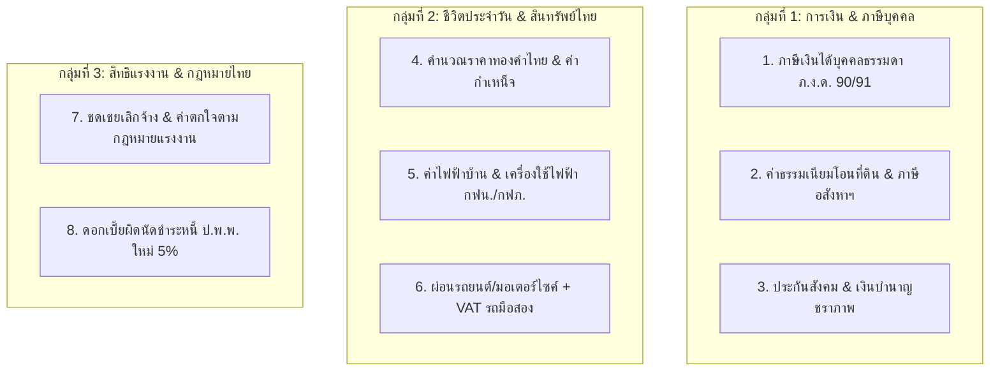

# แผนผังและสารบัญเครื่องคำนวณสไตล์ไทย (Thai-Centric Calculators Roadmap & Backlog)
> เอกสารรวบรวมรายการและข้อกำหนดทางเทคนิค (Functional & Technical Specifications) ของเครื่องคำนวณที่คนไทยใช้งานบ่อย เพื่อเตรียมพัฒนาเพิ่มเติมในระบบ **Multitools Calculator AIO**

---

## 📌 บทนำและสถานะปัจจุบัน (Current State)
ปัจจุบันระบบมีเครื่องคิดเลขทั้งหมด **31 เครื่องมือ** แบ่งเป็น 5 หมวดหมู่:
1. **ช้อปปิ้ง & ทั่วไป (5):** `unit_price`, `discount`, `gold_thai`, `tip`, `unit`
2. **ธุรกิจ & ค้าขาย (4):** `vat`, `vat_wht`, `percent`, `salary`
3. **การเงิน & วางแผน (8):** `loan`, `savings`, `tax_personal`, `property_transfer`, `car_loan`, `currency`, `lotto_calc`, `legal_interest`
4. **เวลา & สำนักงาน (6):** `social_security`, `labor_severance`, `date_work`, `date_calc`, `world_time`, `gpa`
5. **สุขภาพ & พิเศษ (8):** `health`, `ovulation`, `fuel_cost`, `fuel_eff`, `electricity_bill`, `area_cost`, `hex`, `calc`

เป้าหมายของ Roadmap นี้คือการต่อยอดด้วยเครื่องคำนวณที่ **แก้ Pain Point ชีวิตจริงของคนไทย อิงตามข้อกฎหมาย ภาษี และพฤติกรรมท้องถิ่น (Thai Regulatory & Cultural Alignment)**

---

## 📋 รายการเครื่องคำนวณใหม่ 8 รายการ (Catalog Backlog)

---

### กลุ่มที่ 1: การเงิน & ภาษีตามกฎหมายไทย (High Impact / Search Volume สูงสุด)

#### 1. ภาษีเงินได้บุคคลธรรมดา (ภ.ง.ด. 90 / 91)
* **รหัสโมดูล:** `tax_personal`
* **Pain Point:** มนุษย์เงินเดือนและฟรีแลนซ์ไม่มั่นใจว่าตัวเองต้องจ่ายภาษีเท่าไหร่ ได้เงินคืนไหม หรือซื้อลดหย่อนเพิ่มจะคุ้มค่าเพียงใด
* **สูตรและตรรกะการคำนวณ:**
  $$\text{เงินได้สุทธิ} = \text{เงินได้พึงประเมินทั้งปี} - \text{ค่าใช้จ่าย (50\% สูงสุด 100,000 บ.)} - \text{ค่าลดหย่อนรวม}$$
  * **อัตราภาษีเงินได้บุคคลธรรมดาแบบขั้นบันได (7 ขั้น):**
    * 0 - 150,000 บาท : ยกเว้นภาษี (0%)
    * 150,001 - 300,000 บาท : 5% (สูงสุด 7,500 บาท)
    * 300,001 - 500,000 บาท : 10% (สูงสุด 20,000 บาท)
    * 500,001 - 750,000 บาท : 15% (สูงสุด 37,500 บาท)
    * 750,001 - 1,000,000 บาท : 20% (สูงสุด 50,000 บาท)
    * 1,000,001 - 2,000,000 บาท : 25% (สูงสุด 250,000 บาท)
    * 2,000,001 - 5,000,000 บาท : 30% (สูงสุด 900,000 บาท)
    * เกิน 5,000,000 บาท : 35%
* **ค่าลดหย่อนหลักที่รองรับ:**
  * ลดหย่อนส่วนตัว (60,000 บ.), คู่สมรส (60,000 บ.), บุตร (30,000 - 60,000 บ.), บิดามารดา (คนละ 30,000 บ.)
  * ประกันสังคม (สูงสุด 9,000 บ.), กองทุนสำรองเลี้ยงชีพ / กบข. (สูงสุด 15% ไม่เกิน 500,000 บ.)
  * ประกันชีวิตทั่วไป (สูงสุด 100,000 บ.), ประกันสุขภาพ (สูงสุด 25,000 บ., รวมประกันชีวิตไม่เกิน 100,000 บ.)
  * ดอกเบี้ยเงินกู้ยืมเพื่อซื้อที่อยู่อาศัย (สูงสุด 100,000 บ.)
  * กองทุนลดหย่อนภาษี: SSF, RMF, Thai ESG (ตามเพดานกฎหมาย)
  * เงินบริจาคทั่วไป (ตามจริงไม่เกิน 10% ของเงินได้หลังหักลดหย่อน) / เงินบริจาคเพื่อการศึกษา/กีฬา (ลดหย่อนได้ 2 เท่า)
* **ผลลัพธ์ที่แสดง:**
  * ฐานภาษีสูงสุดที่ตกอยู่ (Marginal Tax Rate)
  * ภาษีที่ต้องชำระทั้งสิ้น เทียบกับภาษีที่ถูกหัก ณ ที่จ่ายไปแล้ว (ได้คืน / ต้องจ่ายเพิ่ม)
  * แถบแนะนำสิทธิลดหย่อนที่ยังเหลือ และอัตราการประหยัดภาษีต่อเงินลงทุน 10,000 บาท

---

#### 2. ค่าธรรมเนียมโอนที่ดิน & ภาษีซื้อขายอสังหาริมทรัพย์ (กรมที่ดิน)
* **รหัสโมดูล:** `property_transfer`
* **Pain Point:** ผู้ซื้อและผู้ขายตกลงกันเรื่องค่าใช้จ่ายวันโอนกรรมสิทธิ์ไม่ชัดเจน สับสนระหว่างราคาประเมิน vs ราคาซื้อขายจริง
* **รายการค่าใช้จ่ายที่คำนวณ:**
  1. **ค่าธรรมเนียมการโอนกรรมสิทธิ์:** 2% ของราคาประเมินทุนทรัพย์ (หรืออัตราพิเศษตามมาตรการรัฐ เช่น 0.01%)
  2. **ค่าจดทะเบียนจำนอง:** 1% ของยอดวงเงินกู้สินเชื่อ (กรณีผู้ซื้อกู้ธนาคาร)
  3. **ภาษีธุรกิจเฉพาะ vs อากรแสตมป์:**
     * *ภาษีธุรกิจเฉพาะ:* 3.3% ของราคาประเมินหรือราคาซื้อขายจริง (ใช้ยอดที่สูงกว่า) — บังคับใช้กรณีถือครองน้อยกว่า 5 ปี หรือไม่มีชื่อในทะเบียนบ้านเกิน 1 ปี
     * *อากรแสตมป์:* 0.5% ของราคาประเมินหรือราคาซื้อขายจริง (ใช้ยอดที่สูงกว่า) — ใช้กรณีที่ไม่ต้องเสียภาษีธุรกิจเฉพาะ
  4. **ภาษีเงินได้หัก ณ ที่จ่ายบุคคลธรรมดา:** คำนวณตามราคาประเมินของกรมที่ดิน หักค่าใช้จ่ายตามจำนวนปีที่ถือครอง (ตามตรรกะของกรมสรรพากร)
* **ผลลัพธ์ที่แสดง:**
  * ยอดรวมค่าใช้จ่ายทั้งหมด ณ สำนักงานที่ดิน
  * สรุปการแบ่งจ่ายตามธรรมเนียมปฏิบัติ (ตกลงออกคนละครึ่ง / ผู้ขายออกทั้งหมด / ผู้ซื้อจ่ายเฉพาะค่าจดจำนอง)

---

#### 3. ประกันสังคม & เงินบำนาญชราภาพ (ม.33 / ม.39 / ม.40)
* **รหัสโมดูล:** `social_security`
* **Pain Point:** ผู้ประกันตนไม่ทราบว่าตนเองสะสมเงินเข้ากองทุนเท่าใด และเมื่ออายุครบ 55 ปีจะได้รับเงินบำนาญเดือนละเท่าไหร่
* **สูตรและตรรกะการคำนวณ:**
  * **เงินสมทบรายเดือน:** ม.33 หัก 5% (ฐานค่าจ้างขั้นต่ำ 1,650 บ. - สูงสุด 15,000 บ. = หัก 750 บ./เดือน)
  * **กรณีบำนาญชราภาพ (จ่ายครบ 180 เดือนขึ้นไป):**
    $$\text{เงินบำนาญต่อเดือน} = \text{ฐานค่าจ้างเฉลี่ย 60 เดือนสุดท้าย} \times \left(20\% + 1.5\% \times \left\lfloor\frac{\text{เดือนที่จ่ายเกิน 180}}{12}\right\rfloor\right)$$
  * **กรณีบำเหน็จชราภาพ (จ่ายน้อยกว่า 180 เดือน):**
    * จ่าย < 12 เดือน: ได้รับเฉพาะเงินสมทบส่วนของผู้ประกันตน
    * จ่าย 12 - 179 เดือน: ได้รับเงินสมทบส่วนของผู้ประกันตน + ส่วนของนายจ้าง + ผลประโยชน์ตอบแทนตามประกาศ สปส.

---

### กลุ่มที่ 2: ชีวิตประจำวัน & ซื้อขายสินทรัพย์แบบไทย (Everyday Thai Lifestyle)

#### 4. คำนวณราคาทองคำไทย (ทองแท่ง / รูปพรรณ / สลึง / ค่ากำเหน็จ)
* **รหัสโมดูล:** `gold_thai`
* **Pain Point:** คนไทยซื้อขายทองคำเยาวราช แต่สับสนเรื่องหน่วยน้ำหนักสลึง-กรัม และส่วนต่างค่ากำเหน็จกับราคาหักคืน
* **สูตรและตรรกะการคำนวณ:**
  * **น้ำหนักมาตรฐานไทย (ความบริสุทธิ์ 96.5%):**
    * 1 บาททองแท่ง = 15.244 กรัม | 1 บาททองรูปพรรณ = 15.16 กรัม
    * 1 บาท = 4 สลึง = 100 สตางค์
  * **การคำนวณราคาซื้อ:**
    $$\text{ราคาซื้อสุทธิ} = (\text{ราคาทองคำแท่ง/รูปพรรณตามประกาศ} \times \text{จำนวนบาท}) + \text{ค่ากำเหน็จ}$$
  * **การคำนวณราคาขายคืน (ตามเกณฑ์ สคบ. / สมาคมค้าทองคำ):**
    * ทองแท่ง: หักไม่เกิน 100 บาทต่อบาททองคำจากราคาขายออก
    * ทองรูปพรรณ: หักไม่เกิน 5% จากราคารับซื้อทองคำแท่งของวันนั้น
  * โหมดคำนวณกำไร/ขาดทุนจากการออมทอง (เทียบราคาต้นทุนเฉลี่ย vs ราคาตลาดปัจจุบัน)

---

#### 5. คำนวณค่าไฟฟ้าบ้าน & เครื่องใช้ไฟฟ้า (กฟน. / กฟภ.)
* **รหัสโมดูล:** `electricity_bill`
* **Pain Point:** ปัญหาค่าไฟแพงหน้าร้อน ความไม่เข้าใจเรื่องอัตราก้าวหน้า ค่าบริการ และค่าไฟฟ้าผันแปร (Ft)
* **สูตรและตรรกะการคำนวณ:**
  * **ประเภทบ้านอยู่อาศัย (กฟน./กฟภ.):**
    * *ประเภท 1.1 (ไม่เกิน 150 หน่วย/เดือน):* ขั้นบันได 7 ระดับ ตั้งแต่ 2.3488 ถึง 4.4217 บาท/หน่วย
    * *ประเภท 1.2 (เกิน 150 หน่วย/เดือน):* ขั้นบันได 3 ระดับ (150 หน่วยแรก, 151-400 หน่วย, เกิน 400 หน่วย)
  * **ส่วนประกอบค่าไฟฟ้ารวม:**
    $$\text{ค่าไฟฟ้ารวม} = (\text{ค่าไฟฟ้าฐาน} + \text{ค่าบริการรายเดือน} + (\text{หน่วยไฟ} \times \text{ค่า Ft})) \times 1.07 \text{ (VAT 7\%)}$$
  * **โหมดคำนวณเครื่องใช้ไฟฟ้าเฉพาะตัว (Wattage Calculator):**
    * เลือกชนิดอุปกรณ์ (แอร์ Inverter 9000-24000 BTU, ตู้เย็น, เครื่องทำน้ำอุ่น, พัดลม, PC เกมมิ่ง)
    * ใส่จำนวนชั่วโมงที่เปิดต่อวัน $\rightarrow$ แปลงเป็นหน่วย Unit/เดือน $\rightarrow$ คำนวณค่ายูนิตเฉลี่ย

---

#### 6. สินเชื่อเช่าซื้อรถยนต์ & มอเตอร์ไซค์ (Car Hire Purchase)
* **รหัสโมดูล:** `car_loan`
* **Pain Point:** ดอกเบี้ยรถคิดแบบ Flat Rate ต่อปี ไม่ใช่ลดต้นลดดอก และรถมือสองมี VAT 7% ซ่อนอยู่ในทุกงวด รวมถึงกฎหมาย สคบ. เรื่องส่วนลดปิดบัญชีก่อนกำหนด
* **สูตรและตรรกะการคำนวณ:**
  * **ยอดจัดเช่าซื้อ:** $\text{ราคารถ} - \text{เงินดาวน์}$
  * **ดอกเบี้ยรวมทั้งสัญญา:** $\text{ยอดจัด} \times \text{อัตราดอกเบี้ยต่อปี (Flat Rate)} \times \text{จำนวนปี}$
  * **ค่างวดก่อน VAT:** $(\text{ยอดจัด} + \text{ดอกเบี้ยรวม}) \div \text{จำนวนงวด}$
  * **กรณีรถมือสอง:** ค่างวดสุทธิ $= \text{ค่างวดก่อน VAT} \times 1.07$
  * **ส่วนลดปิดบัญชีก่อนกำหนดตามประกาศ สคบ. ใหม่:**
    * ปิดยอดก่อนผ่อนชำระงวดที่ 1/3 ของสัญญา $\rightarrow$ ได้รับส่วนลดดอกเบี้ยที่ยังไม่ถึงกำหนด 100%
    * ปิดยอดระหว่าง 1/3 ถึง 2/3 ของสัญญา $\rightarrow$ ได้รับส่วนลดดอกเบี้ย 70%
    * ปิดยอดเกิน 2/3 ของสัญญา $\rightarrow$ ได้รับส่วนลดดอกเบี้ย 60%

---

### กลุ่มที่ 3: สิทธิแรงงาน & กฎหมายไทย (Legal & Employment Rights)

#### 7. คำนวณเงินชดเชยเลิกจ้าง & ค่าตกใจตามกฎหมายแรงงาน
* **รหัสโมดูล:** `labor_severance`
* **Pain Point:** พนักงานถูกเลิกจ้างกะทันหัน หรือปรับโครงสร้างองค์กร ไม่ทราบสิทธิเงินชดเชยตาม พ.ร.บ. คุ้มครองแรงงาน พ.ศ. 2541 (ม.118)
* **เกณฑ์การคำนวณอัตราชดเชย:**
  * อายุงาน 120 วัน แต่ไม่ถึง 1 ปี: ชดเชย **30 วัน** (1 เดือน)
  * อายุงาน 1 ปี แต่ไม่ถึง 3 ปี: ชดเชย **90 วัน** (3 เดือน)
  * อายุงาน 3 ปี แต่ไม่ถึง 6 ปี: ชดเชย **180 วัน** (6 เดือน)
  * อายุงาน 6 ปี แต่ไม่ถึง 10 ปี: ชดเชย **240 วัน** (8 เดือน)
  * อายุงาน 10 ปี แต่ไม่ถึง 20 ปี: ชดเชย **300 วัน** (10 เดือน)
  * อายุงาน 20 ปีขึ้นไป: ชดเชย **400 วัน** (~13.3 เดือน)
* **ส่วนคำนวณเพิ่มเติม:**
  * ค่าบอกกล่าวล่วงหน้า (ค่าตกใจ ม.17): กรณีเลิกจ้างทันทีโดยไม่แจ้งล่วงหน้า 1 งวดการจ่ายค่าจ้าง
  * ค่าจ้างวันหยุดพักผ่อนประจำปีคงเหลือตามส่วน (พักร้อนที่ยังไม่ได้ใช้)

---

#### 8. ดอกเบี้ยผิดนัดชำระหนี้ตามกฎหมายใหม่ (ป.พ.พ. ม.7 และ ม.224)
* **รหัสโมดูล:** `legal_interest`
* **Pain Point:** การคิดดอกเบี้ยผิดนัดชำระหนี้ทางแพ่งหลังจากมี พ.ร.ก. แก้ไขประมวลกฎหมายแพ่งและพาณิชย์ พ.ศ. 2564
* **หลักเกณฑ์ตามกฎหมาย:**
  * อัตราดอกเบี้ยที่ไม่ได้กำหนดไว้ในสัญญา: เดิม 7.5% ต่อปี $\rightarrow$ **ลดเหลือ 3% ต่อปี** (ปรับปรุงตามประกาศ ธปท. ทุก 3 ปี)
  * อัตราดอกเบี้ยผิดนัดชำระหนี้: อัตราตาม ม.7 + 2% = **5% ต่อปี**
  * **วิธีคำนวณแบบรายวันตามงวดที่ผิดนัดจริง:** ห้ามคิดดอกเบี้ยจากเงินต้นงวดที่ยังไม่ถึงกำหนดชำระ
  * สามารถใส่วันที่ครบกำหนดชำระ $\rightarrow$ วันที่ชำระจริง เพื่อคำนวณเบี้ยปรับเป็นรายวันได้อย่างแม่นยำ

---

### กลุ่มที่ 4: ส่วนขยายเศรษฐกิจจริง ค้าขาย & บริหารหนี้ (Phase 8 & 9 Roadmap)

#### 9. ค่าล่วงเวลา OT & ค่าทำงานวันหยุดตามกฎหมายแรงงาน
* **รหัสโมดูล:** `ot_calc` (หมวดหมู่ `work` / เวลา & สำนักงาน)
* **Pain Point:** พนักงานเงินเดือนและพนักงานรายวันสับสนวิธีคำนวณอัตราคูณ OT ตาม พ.ร.บ. คุ้มครองแรงงาน พ.ศ. 2541 ว่าวันธรรมดา วันหยุด หรือล่วงเวลาในวันหยุดได้อัตราเท่าไร
* **สูตรและตรรกะการคำนวณ:**
  * ฐานค่าจ้างรายชั่วโมง: พนักงานรายเดือน = $\text{เงินเดือน} / 30 / 8\text{ ชม.}$, พนักงานรายวัน = $\text{ค่าจ้างรายวัน} / 8\text{ ชม.}$
  * **ม.61 OT วันทำงานปกติ:** อัตรา **1.5 เท่า** ของค่าจ้างรายชั่วโมง
  * **ม.62 ค่าทำงานในวันหยุด (เวลาทำงานปกติ 8 ชม.):**
    * พนักงานรายเดือน: ได้รับเพิ่ม **1 เท่า** (เนื่องจากได้รับเงินเดือนในวันหยุดอยู่แล้ว)
    * พนักงานรายวัน: ได้รับ **2 เท่า** (เนื่องจากไม่ได้รับค่าจ้างในวันหยุด)
  * **ม.63 OT ในวันหยุด (ทำงานล่วงเวลาเกิน 8 ชม. ในวันหยุด):** อัตรา **3 เท่า** ของค่าจ้างรายชั่วโมง
* **ฟีเจอร์ที่แสดงผล:**
  * สรุปจำนวนชั่วโมงด่วน (Quick Hours) หรือ บันทึกกะเวลาเข้า-ออกหักเวลาพัก
  * ค่าแรงล่วงหน้าแยกแต่ละประเภท พร้อมยอดรวมค่าล่วงเวลาประจำเดือน
  * เชื่อมต่อยอดไปคำนวณเงินได้สุทธิและการหักภาษี ณ ที่จ่าย

#### 10. กำไรสุทธิขายของออนไลน์ & ค่าธรรมเนียมมาร์เก็ตเพลส
* **รหัสโมดูล:** `ecommerce_profit` (หมวดหมู่ `biz` / ธุรกิจ & ค้าขาย)
* **Pain Point:** ผู้ขาย Shopee, Lazada, TikTok Shop, และขายตรง สับสนค่าธรรมเนียมหลายชั้น ขายราคาตั้งแล้วเหลือกำไรจริงกี่บาท หรือขาดทุนไม่รู้ตัว
* **ตรรกะการคำนวณ:**
  * ราคาขายตั้งต้น + ค่าส่งที่ลูกค้าจ่าย
  * หัก: ต้นทุนสินค้า, ค่าส่งที่ร้านออกเพิ่ม, คูปองส่วนลดร้านค้า
  * หัก: ค่าธรรมเนียมคำสั่งซื้อ/ธุรกรรม (Payment/Transaction Fee ~3-4%)
  * หัก: ค่าคอมมิชชันแพลตฟอร์ม (Marketplace Commission Fee ~4-13% ตามหมวดหมู่)
  * หัก: ค่าโฆษณา/ยิงแอด (Ad Spend %)
  * หัก: VAT 7% ของค่าธรรมเนียมแพลตฟอร์ม
* **ผลลัพธ์ที่แสดงผล:**
  * กำไรสุทธิต่อออเดอร์ (Net Profit) และ Profit Margin %
  * ราคาขายขั้นต่ำที่ไม่ขาดทุน (Breakeven Price)

#### 11. รีไฟแนนซ์บ้าน vs Retention ธนาคารเดิม & จุดคุ้มทุน
* **รหัสโมดูล:** `refinance_home` (โหมดเสริมในหมวด `loan` / เงินกู้)
* **Pain Point:** ลูกหนี้บ้านผ่อนครบ 3 ปี ลังเลว่าจะขอลดดอกเบี้ยแบงก์เดิม (Retention) หรือย้ายแบงก์ใหม่ (Refinance) จะคุ้มค่าธรรมเนียมหรือไม่
* **ตรรกะการคำนวณ (อ้างอิงแนวทาง ธปท.):**
  * เปรียบเทียบ 3 ปีแรก: ดอกเบี้ยเดิม vs Retention (ดอกเบี้ย ~3.8% ไม่มีค่าธรรมเนียม) vs Refinance (ดอกเบี้ย ~2.9% มีค่าธรรมเนียม)
  * รวมค่าใช้จ่ายรีไฟแนนซ์: ค่าจดจำนอง 1% ของวงเงินกู้, ค่าประเมินหลักทรัพย์ (2,500-3,000 บ.), ค่าอากรแสตมป์ 0.05%, ประกันอัคคีภัย
  * **จุดคุ้มทุน (Breakeven Month):** จำนวนเดือนที่ดอกเบี้ยประหยัดได้จะครอบคลุมค่าใช้จ่ายในการย้ายค่ายทั้งหมด

---

## 🚀 ลำดับขั้นตอนการพัฒนาที่แนะนำ (Development Phases)

| ลำดับ Phase | สถานะ | เครื่องมือเป้าหมาย | เหตุผล & ผลลัพธ์ที่คาดหวัง |
| :--- | :--- | :--- | :--- |
| **Phase 4** | ✅ เสร็จสมบูรณ์ (Completed) | 1. ภาษีเงินได้บุคคลธรรมดา (`tax_personal`) 2. ค่าโอนที่ดิน & ภาษีอสังหาฯ (`property_transfer`) | ตอบโจทย์ธุรกรรมการเงินและอสังหาฯ ที่มี Search Volume สูงที่สุดในไทย เสริมพลังให้เครื่องมือ `salary` และ `area_cost` ที่มีอยู่เดิม |
| **Phase 5** | ✅ เสร็จสมบูรณ์ (Completed) | 3. คำนวณราคาทองคำไทย (`gold_thai`) 4. ค่าไฟฟ้า & เครื่องใช้ไฟฟ้า (`electricity_bill`) | เข้าถึงชีวิตประจำวันของคนไทยทุกคน อัปเดตตารางค่าไฟ Ft และส่วนต่างทองคำแท่ง/รูปพรรณ |
| **Phase 6** | ✅ เสร็จสมบูรณ์ (Completed) | 5. ผ่อนรถยนต์ Flat Rate + VAT (`car_loan`) 6. บำนาญชราภาพ ประกันสังคม (`social_security`) | เจาะกลุ่มผู้ซื้อรถและผู้ประกันตนกว่า 12 ล้านคนในระบบประกันสังคม |
| **Phase 7** | ✅ เสร็จสมบูรณ์ (Completed) | 7. ชดเชยเลิกจ้างตามกฎหมายแรงงาน (`labor_severance`) 8. ดอกเบี้ยผิดนัดชำระ ป.พ.พ. 5% (`legal_interest`) | เติมเต็มเครื่องมือทางกฎหมายและสิทธิประโยชน์แรงงานไทยให้ครบถ้วนสมบูรณ์ (ยอดรวม 31 in 1) |
| **Phase 8** | ✅ เสร็จสมบูรณ์ (Completed) | **ชุดเครื่องมือเศรษฐกิจจริง & บริหารหนี้สิน (Real Economy & Debt):** 1. ✅ **ค่าล่วงเวลา OT & ค่าทำงานวันหยุด** (`ot_calc`) 2. ✅ **กำไรสุทธิขายของออนไลน์ & Shopee/TikTok Fee** (`ecommerce_profit`) 3. ✅ **รีไฟแนนซ์บ้าน vs Retention ธนาคารเดิม & จุดคุ้มทุน ธปท.** (`refinance_home` / `loan`) | แก้ Pain Point มนุษย์เงินเดือน, พ่อค้าแม่ค้าออนไลน์ และลูกหนี้บ้าน ที่ต้องการตัดสินใจทางการเงินจริง |
| **Phase 9** | 🚀 กำลังพัฒนา (In Progress) | **ชุดบริหารเงิน ค้าขาย & พลังงาน (Advanced Utilities & Budgeting):** 4. ✅ เงินเดือนสุทธิรับจริง Take-Home Pay (แท็บเสริมใน `salary`) 5. ✅ แผนปลดหนี้หลายบัญชี Debt Snowball vs Avalanche (`debt_payoff`) 6. 🆕 คำนวณต้นทุนอาหาร/เครื่องดื่ม F&B Recipe Costing (`food_costing`) 7. 🔀 ค่าชาร์จรถ EV & เทียบความคุ้มค่ารถน้ำมัน (แท็บเสริมใน `fuel_cost`) 8. 🆕 คำนวณวัสดุก่อสร้าง/ปรับปรุงบ้าน กระเบื้อง/สี/ปูน (`construction_calc`) | ขยายขีดความสามารถครอบคลุมผู้ประกอบการร้านอาหาร, เจ้าของรถ EV และผู้มีภาระหนี้หลายบัญชี |
| **Phase 10** | 📌 วางแผนไว้ (Planned) | **Desktop Responsive & Smart Visualizations** • ปรับ Layout จอใหญ่ 2-3 คอลัมน์ • กราฟ Donut/Waterfall & ตารางเต็ม • What-If Simulator & กล่องคำแนะนำ | ยกระดับการใช้งานบนเดสก์ท็อป/แท็บเล็ต เติมเต็มพื้นที่ว่างด้วยข้อมูลเชิงลึก โดยรับประกันว่าไม่กระทบหน้าจอมือถือ (Zero Mobile Impact) |

---

### 🖥️ รายละเอียดแผนงาน Phase 8: ยกระดับเดสก์ท็อป & การแสดงผลอัจฉริยะ (Desktop Expansion Spec)
แนวคิดหลักคือ **Single Responsive Codebase (Mobile-First)** เพื่อให้บำรุงรักษาง่าย โค้ดคำนวณชุดเดิม และหน้าจอมือถือยังคงคลีนเหมือนเดิม 100%

1. **โครงสร้าง Adaptive Multi-Column Layout:**
   * **จอเล็ก (Mobile < 768px):** คงกรอบมือถือกะทัดรัด แป้นพิมพ์ใช้งานง่าย ไม่รกสายตา
   * **จอใหญ่ (Desktop $\ge$ 1024px):** ปลดล็อกความกว้างเป็น 3 คอลัมน์:
     * *คอลัมน์ 1 (ซ้าย ~280px):* Navigation Sidebar ตรึงถาวร ค้นหาและสลับ 31 เครื่องมือได้ทันทีไม่ต้องกดปุ่มแฮมเบอร์เกอร์
     * *คอลัมน์ 2 (กลาง ~480px):* ฟอร์มกรอกตัวเลขและตัวเลือกเครื่องมือหลัก
     * *คอลัมน์ 3 (ขวา เต็มพื้นที่ที่เหลือ):* การ์ดสรุปผล กราฟชาร์ต และตารางแจกแจงแบบเรียลไทม์
2. **กราฟและชาร์ตภาพรวม (Interactive Visualizations):**
   * *สินเชื่อและผ่อนรถ (`loan`, `car_loan`):* Donut Chart สัดส่วนเงินต้น vs ดอกเบี้ย และกราฟเส้นลดหนี้ตลอดสัญญา
   * *ภาษีบุคคล (`tax_personal`):* Waterfall Chart แจกแจงการหักค่าใช้จ่าย/ลดหย่อน และ Tax Bracket Gauge วัดระยะห่างสู่ฐานภาษีถัดไป
   * *จัดสรรเงินเดือน (`salary`):* Pie Chart สัดส่วน 50/30/20
3. **ตารางแจกแจงฉบับสมบูรณ์ (Full Schedules):**
   * ตารางส่วนลดปิดบัญชีก่อนกำหนด สคบ. ครบทุกงวด (งวด 1 ถึง 60) เปรียบเทียบยอดประหยัด
   * ตารางจัดอันดับเครื่องใช้ไฟฟ้าที่กินไฟมากที่สุดในบ้าน (`electricity_bill`)
   * ตารางเปรียบเทียบค่าธรรมเนียมวันโอนฝั่งผู้ซื้อ vs ผู้ขาย แบบ Side-by-Side (`property_transfer`)
4. **การจำลองสถานการณ์คู่ขนาน (What-If Sliders):**
   * สไลเดอร์ทดลองเพิ่มเงินดาวน์, สไลเดอร์โปะค่างวดบ้าน, หรือสไลเดอร์ลดชั่วโมงเปิดแอร์ เพื่อดูตัวเลขเงินที่ประหยัดได้แบบ Instant Delta
5. **กล่องคำแนะนำอัจฉริยะเฉพาะบุคคล (Smart Financial Insights):**
   * คำนวณโควตาลดหย่อนภาษีที่ยังเหลืออยู่ พร้อมระบุจำนวนเงินสดที่จะได้คืนหากซื้อเพิ่ม
   * คำนวณผลประโยชน์บำนาญประกันสังคมหากส่งสมทบเพิ่มอีก 1-5 ปี
6. **หลักประกันความปลอดภัยต่อหน้าจอมือถือ (Zero Mobile Impact Guarantee):**
   * ใช้เทคนิค Tailwind `hidden lg:block` และ Progressive Disclosure กราฟและตารางเสริมจะแสดงผลเฉพาะบนจอใหญ่เท่านั้น หน้าจอมือถือจะไม่ถูกรบกวนหรือเพิ่มภาระโหลดใดๆ

---

## 🛠 มาตรฐานทางเทคนิคสำหรับการพัฒนาในอนาคต (Engineering Standards)
เพื่อให้เครื่องมือใหม่สามารถทำงานร่วมกับ Ecosystem ของ Multitools ได้อย่างไร้รอยต่อ ต้องปฏิบัติตามมาตรฐานเดิม:
1. **Catalog Registration:** เพิ่ม Metadata ใน `TOOLS_CATALOG` พร้อมระบุ `category`, `keywords`, และ `faIcon`
2. **State & URL Sync:** รองรับ `syncUrl()` เพื่อให้แชร์ลิงก์พร้อมค่าที่กรอกได้
3. **Drawer History & Saved Sets:** รองรับการบันทึกประวัติการคำนวณอัตโนมัติลงใน `localStorage`
4. **Compare & Print Support:** เชื่อมต่อกับ Quick Compare Modal (`#compareModal`) และฟังก์ชันพิมพ์ใบสรุปทางการ (`generateFormalPrintHTML`)
5. **Quality Assurance:** เขียน Unit Test ใน `calculator_AIO/tests/correctness.test.cjs` ครอบคลุมเคสขอบเขต (Edge cases) และรันผ่าน 100%
