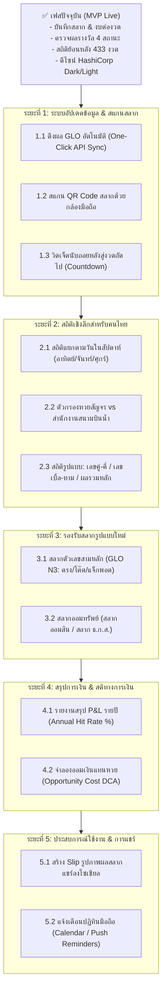

# แผนงานและแนวทางการพัฒนา LottoBook (Roadmap)
> **สมุดสลากและสถิติย้อนหลัง | Thai Lottery Logbook & Historical Stats**  
> เอกสารแผนงานกลยุทธ์ ฟีเจอร์ที่วางแผนพัฒนา และสถาปัตยกรรมระบบในเครือ Multitools

---

## 1. วิสัยทัศน์และหลักการออกแบบ (Core Design Principles)

1. **Local-first & Privacy by Default**: ข้อมูลสลาก งบประมาณ และการเงินของผู้ใช้จัดเก็บในเครื่อง (LocalStorage / IndexedDB) ไม่ส่งออกไปยังเซิร์ฟเวอร์ภายนอก มีระบบสำรองข้อมูล (JSON / CSV)
2. **HashiCorp Technical Canvas System**: ยึดถือแนวทางดีไซน์ตาม [`DESIGN.md`](./DESIGN.md) และ [`tokens.css`](./tokens.css) (Dark Canvas `#000000`, ระดับพื้นผิว Surface-1 ถึง Surface-3, เส้นขอบ 1px Hairline, และสีอัตลักษณ์ประจำแต่ละฟังก์ชัน)
3. **Strict Data Integrity**: รักษารูปแบบข้อความ (String) สำหรับเลขสลากเสมอเพื่อคงเลข 0 นำหน้า (`'007'`, `'09'`) และแยกขาดระหว่าง "รางวัลเลขท้าย 2 ตัวเฉพาะ" ออกจาก "เลข 2 ตัวท้ายที่ตัดจากรางวัลที่ 1"
4. **Anti-Gambler's Fallacy & Financial Literacy**: สถิติเป็นข้อมูลจริงในอดีตเพื่อการศึกษา โดยเน้นย้ำความน่าจะเป็นอิสระ (Independent Events) พร้อมส่งเสริมการควบคุมงบประมาณและวินัยทางการเงิน

---

## 2. ลำดับระยะการพัฒนา (Phased Roadmap)

---

## 3. รายละเอียดฟีเจอร์ในแต่ละระยะ

### ระยะที่ 1: ระบบอัปเดตข้อมูล & สแกนสลาก (Automation & Quick Capture)
* [ ] **1.1 ปุ่มดึงผลรางวัลล่าสุดอัตโนมัติ (Live GLO Auto-Fetch)**:
  * เชื่อมต่อ API / GLO Data Catalog ดึงผลรางวัลทันทีเมื่อถึงเวลา 16:00 น. ของวันออกรางวัล
  * ระบบแจ้งเตือนเมื่อพบผลรางวัลงวดใหม่ พร้อมอัปเดตแคชในเครื่องอัตโนมัติ
* [ ] **1.2 สแกนสลากด้วยกล้อง (QR Code / Barcode Scanner)**:
  * ใช้ Web APIs (เช่น `BarcodeDetector` / `html5-qrcode`) สแกน QR Code บนสลากกินแบ่งใบจริงและสลากดิจิทัล (เป๋าตัง)
  * ดึงเลข 6 หลัก งวดวันที่ และจำนวนใบลงฟอร์มได้ทันทีโดยไม่ต้องพิมพ์
* [ ] **1.3 วิดเจ็ตนับถอยหลังสู่งวดถัดไป (Next Draw Countdown Widget)**:
  * การ์ดหัวหน้าเว็บแสดงเวลานับถอยหลังสู่งวดถัดไป (เช่น วันที่ 1 หรือ 16 ของเดือน)
  * สรุปงบประมาณที่เหลืออยู่สำหรับงวดนั้น เพื่อเตือนสติก่อนซื้อ

---

### ระยะที่ 2: สถิติเชิงลึกสำหรับคนไทย (Advanced Thai Lottery Analytics)
* [ ] **2.1 สถิติแยกตาม "วันในสัปดาห์" (Day-of-Week Stats)**:
  * วิเคราะห์สถิติว่างวดที่ตรงกับวันอาทิตย์ วันจันทร์ หรือวันศุกร์ ตัวเลข 2 ตัวท้าย และการกระจายตัวเลข 0–9 มักออกอย่างไร
* [ ] **2.2 ตัวกรอง "หวยสัญจร" vs "สนามบินน้ำ" (Mobile Draw Filter)**:
  * คัดกรองและเปรียบเทียบสถิติเฉพาะงวดที่ออกรางวัลสัญจรตามต่างจังหวัด เทียบกับงวดปกติที่ออก ณ สำนักงานสนามบินน้ำ
* [ ] **2.3 การวิเคราะห์รูปแบบตัวเลข (Pattern Analytics)**:
  * **สัดส่วนคู่-คี่**: คู่-คู่, คู่-คี่, คี่-คู่, คี่-คี่
  * **เลขเบิ้ลและเลขหาม**: ความถี่ของเลขเบิ้ล (00, 11, ..., 99) และเลขหาม 3 ตัว (เช่น 575, 818)
  * **ผลรวมของตัวเลข (Sum of Digits)**: สถิติผลรวมเลข 2 ตัวท้าย (เช่น รวมได้ 9, รวมได้ 10)

---

### ระยะที่ 3: รองรับสลากรูปแบบใหม่ (Extended Lottery Products)
* [ ] **3.1 สลากตัวเลขสามหลัก (GLO N3)**:
  * เพิ่มระบบบันทึกและตรวจรางวัลสลาก N3 รองรับ 4 ประเภทรางวัล:
    1. รางวัล 3 ตัวตรง (ตรงเลข-ตรงหลัก)
    2. รางวัล 3 ตัวสลับหลัก (โต๊ด)
    3. รางวัล 2 ตัวตรง (ตรงเลข-ตรงหลัก)
    4. รางวัลพิเศษ (แจ็กพอตแบบทบยอด)
* [ ] **3.2 สลากออมทรัพย์ (สลากออมสิน / ธ.ก.ส.)**:
  * รองรับการบันทึกสลากเลขเรียง (ซื้อยกหมวด 100 ใบ หรือ 1,000 ใบ)
  * คำนวณดอกเบี้ยเมื่อครบกำหนด และผลตอบแทนขั้นต่ำที่ถูกรางวัลแน่นอนทุกงวด

---

### ระยะที่ 4: สรุปภาพรวมและสติทางการเงิน (Personal Finance & Opportunity Cost)
* [ ] **4.1 รายงานสรุปสถานะการเงินรายปี (Annual Spending & P&L Report)**:
  * สรุปเปรียบเทียบปีต่อปี (เช่น ปี 2567 vs ปี 2568)
  * คำนวณ **Hit Rate % (อัตราความถี่ที่ถูกรางวัลจริง)** และผลตอบแทนสุทธิ (Net ROI)
* [ ] **4.2 แบบจำลอง "ออมเงินแทนซื้อหวย" (Opportunity Cost Simulator)**:
  * นำยอดใช้จ่ายจริงที่บันทึกไว้ มาคำนวณเปรียบเทียบว่า:
    * *หากนำเงินก้อนนี้ไปลงทุน DCA กองทุนดัชนี (ผลตอบแทนเฉลี่ย 7% ต่อปี) ปัจจุบันจะมีเงินเท่าไร?*
    * *หากนำไปซื้อทองคำ หรือฝากประจำ จะมีเงินสะสมกี่บาท?*

---

### ระยะที่ 5: ประสบการณ์ใช้งาน & การแชร์ (UX & Social Sharing)
* [ ] **5.1 Slip รูปภาพสรุปผลสลาก (Shareable Social Card)**:
  * สร้างรูปภาพสรุปการตรวจสลากประจำงวดแบบ Dark Canvas สวยงามตาม HashiCorp design
  * รองรับการดาวน์โหลดเป็นภาพ PNG หรือแชร์เข้า LINE / Facebook ได้ในคลิกเดียว
* [ ] **5.2 แจ้งเตือนผ่านปฏิทินมือถือ (Calendar / Push Reminders)**:
  * สร้างไฟล์ `.ics` หรือปุ่ม *“เพิ่มลงในปฏิทิน Google / Apple Calendar”* เพื่อเตือนช่วงเช้าวันหวยออกและเวลาตรวจผล 16:30 น.

---

## 4. โทเคนสีและสไตล์ที่ต้องใช้ตาม Design System

เมื่อพัฒนาฟีเจอร์ใหม่ ให้เชื่อมโยงกับ Design Tokens ใน [`tokens.css`](./tokens.css) เสมอ:
* ฟีเจอร์เกี่ยวกับการบันทึก/รายการซื้อ: ใช้โทน **ม่วง (`--book-purple` / Terraform `#7b42bc`)**
* ฟีเจอร์เกี่ยวกับงบประมาณ/การเงิน: ใช้โทน **เหลือง/อำพัน (`--book-yellow` / Vault `#ffcf25` & `#bb5a00`)**
* ฟีเจอร์เกี่ยวกับการตรวจผล/แบบฟอร์ม: ใช้โทน **ฟ้าไซแอน (`--book-cyan` / Waypoint `#14c6cb`)**
* ฟีเจอร์เกี่ยวกับสถิติ/กราฟ/การวิเคราะห์: ใช้โทน **น้ำเงิน (`--book-blue` / Vagrant `#1868f2`)**
* ฟีเจอร์สถานะสำเร็จ/เตือน/ผิดพลาด: ใช้โทน **เขียว (`--book-success`)**, **เหลือง (`--book-warning`)**, และ **แดง (`--book-error`)**

---
*เอกสารนี้จัดทำขึ้นเพื่อใช้เป็นแนวทางมาตรฐานในการพัฒนา LottoBook ให้เป็นส่วนหนึ่งของระบบ Multitools อย่างยั่งยืน*
